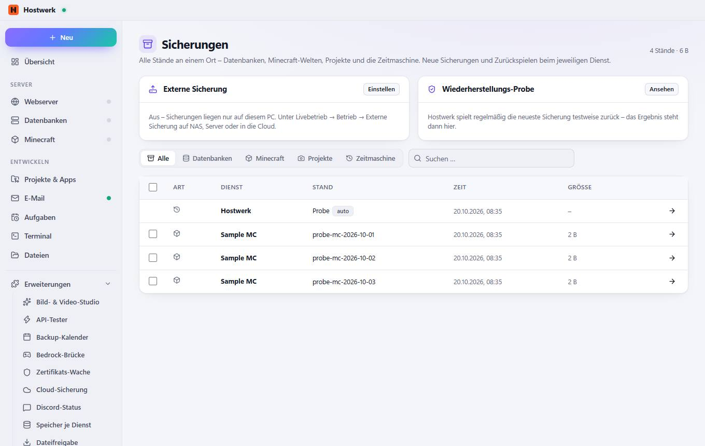

# Sicherungen

[← Zurück zur Übersicht](README.md)

Alle Stände an einem Ort – Datenbanken, Minecraft-Welten, Projekte und die Zeitmaschine. Neue Sicherungen und Zurückspielen beim jeweiligen Dienst.

### Bereiche auf dieser Seite

- Externe Sicherung
- Wiederherstellungs-Probe

### Was du hier tun kannst

- Einstellen
- Ansehen
- Öffnen: Hostwerk
- Öffnen: Sample MC

Erzeugt am 2026-10-20 · Hostwerk 2.10.0
