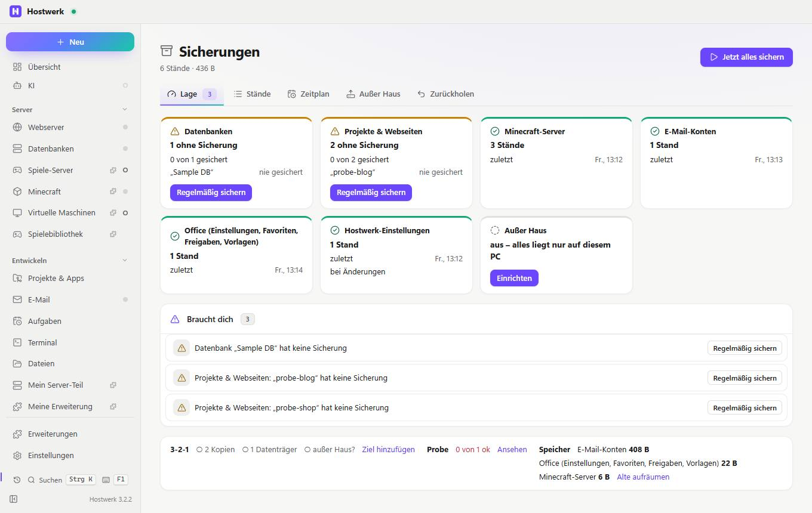
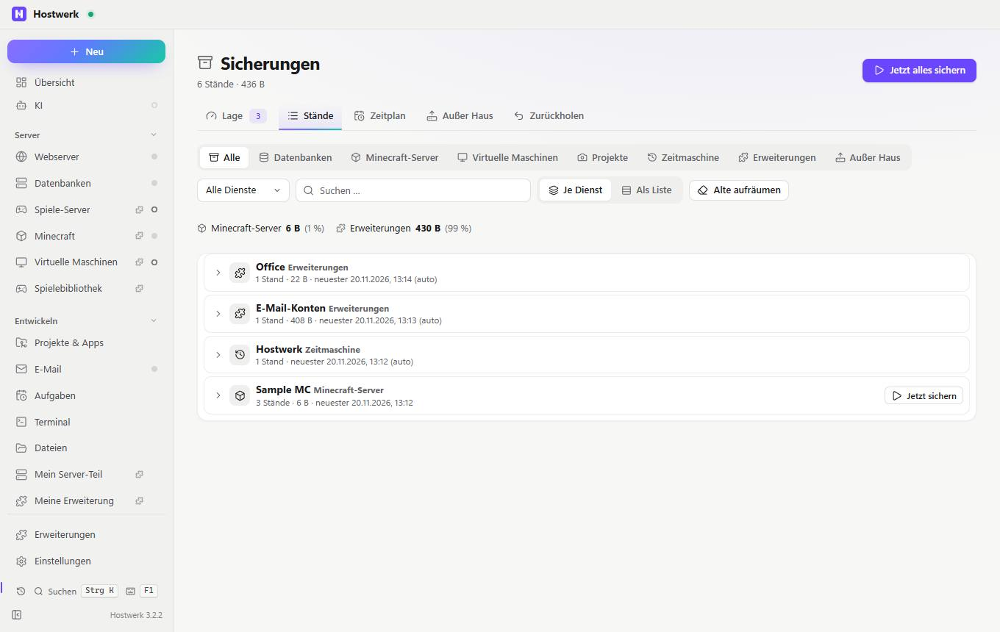
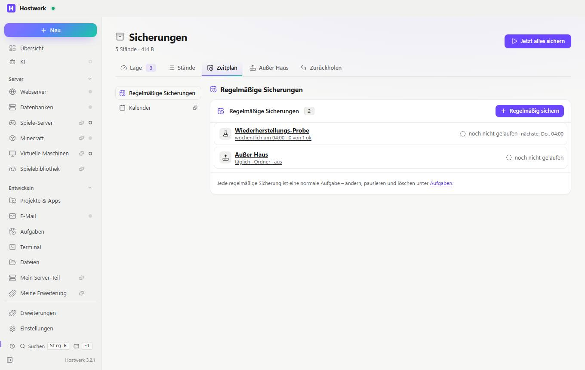
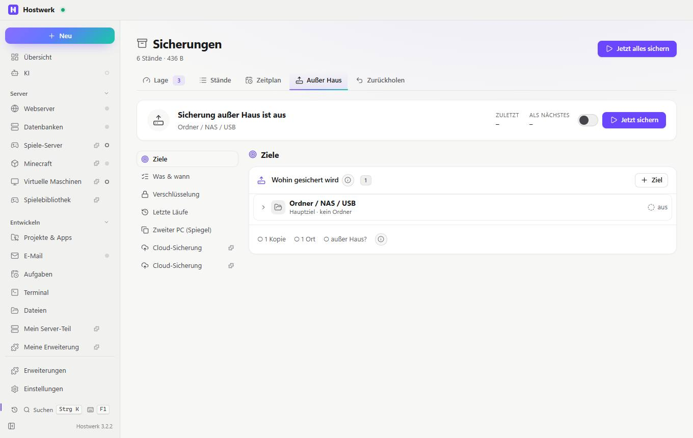
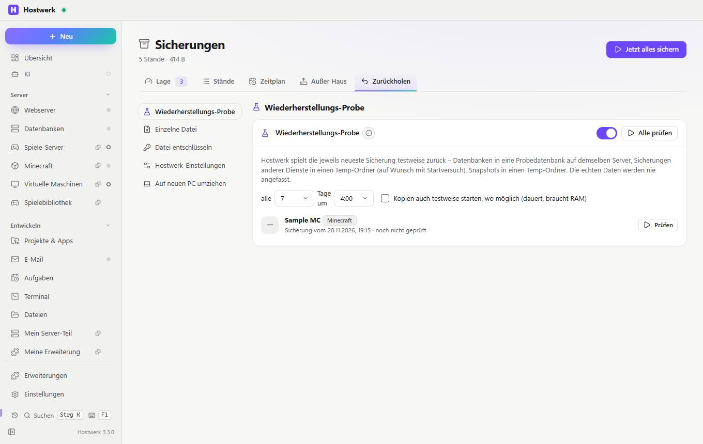

# Sicherungen

[← Zurück zur Übersicht](README.md)

5 Stände · 414 B

### Bereiche auf dieser Seite

- Braucht dich

### Was du hier tun kannst

- Jetzt alles sichern
- Regelmäßig sichern
- Einrichten

## Reiter

### Stände

**Bereiche auf dieser Seite:** Alle Stände

**Was du hier tun kannst:** Jetzt alles sichern · Alte aufräumen · E-Mail-Konten Erweiterungen 1 Stand · 408 B · neuester 20.11.2026, 19:16 (auto) · Hostwerk Zeitmaschine 1 Stand · neuester 20.11.2026, 19:15 (auto) · Sample MC Minecraft-Server 3 Stände · 6 B · neuester 20.11.2026, 19:15 · Jetzt sichern

### Zeitplan

**Bereiche auf dieser Seite:** Regelmäßige Sicherungen

**Was du hier tun kannst:** Jetzt alles sichern · Regelmäßig sichern

### Außer Haus

> 3-2-1-Regel Drei Kopien, auf zwei verschiedenen Arten von Speicher, eine davon außer Haus. Jedes Ziel bekommt dieselbe Sicherung; das Hauptziel ist nur das erste.
> Außer Haus Ein Ordner kann ein NAS im selben Haus sein. Gegen Diebstahl oder Brand hilft ein Ziel woanders – ein SFTP-Server, ein NAS bei Freunden oder die Cloud.

**Bereiche auf dieser Seite:** Ziele · Wohin gesichert wird

**Was du hier tun kannst:** Jetzt alles sichern · Jetzt sichern · Ziel · Ordner / NAS / USB Hauptziel · kein Ordner

### Zurückholen

> Eine Sicherung zählt erst, wenn sie sich zurückspielen lässt

**Bereiche auf dieser Seite:** Wiederherstellungs-Probe

**Was du hier tun kannst:** Jetzt alles sichern · Alle prüfen · Prüfen

Erzeugt am 2026-11-20 · Hostwerk 3.3.0
