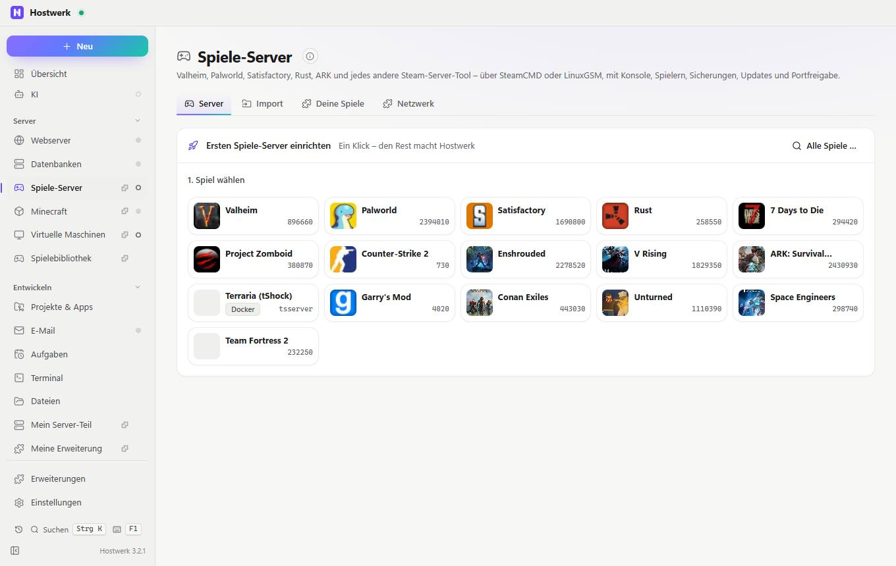
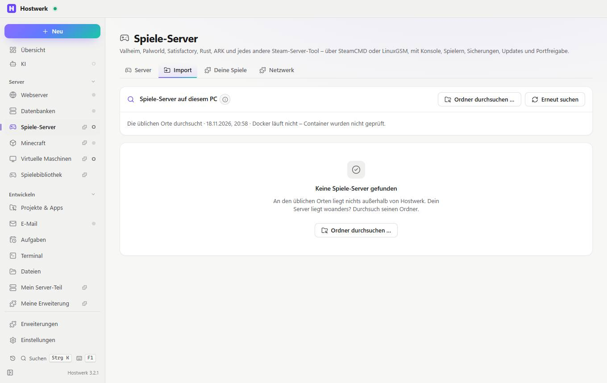
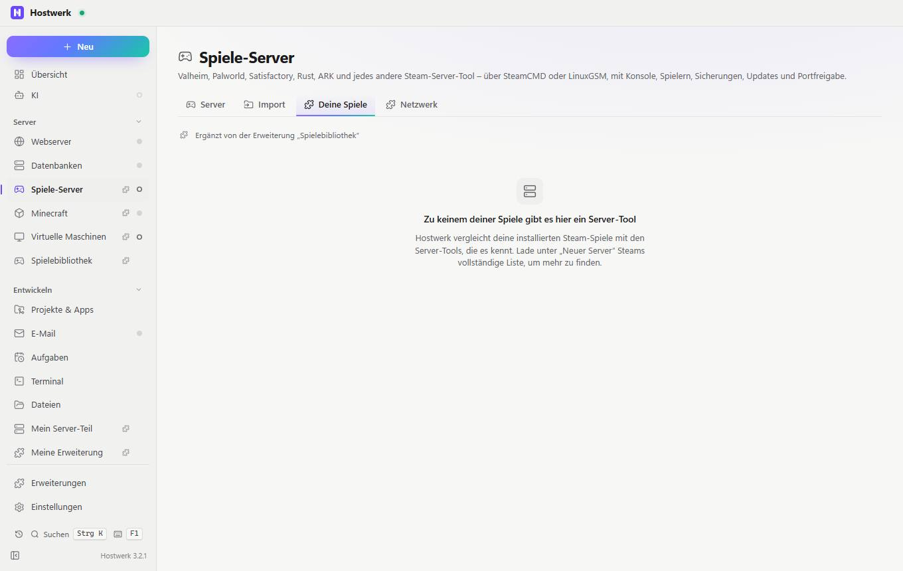
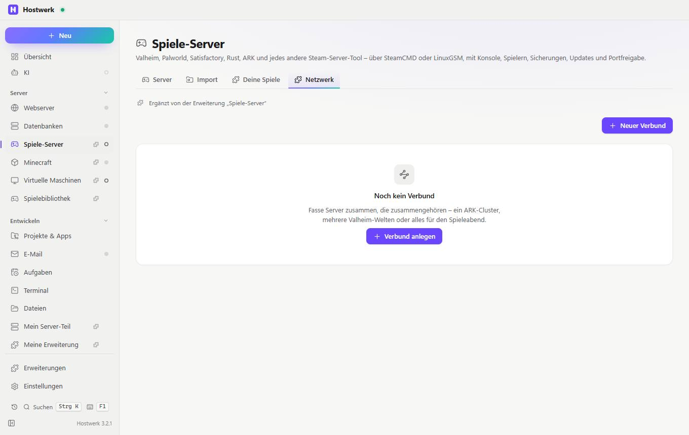

# Spiele-Server

[← Zurück zur Übersicht](README.md)

Valheim, Palworld, Satisfactory, Rust, ARK und jedes andere Steam-Server-Tool – über SteamCMD oder LinuxGSM, mit Konsole, Spielern, Sicherungen, Updates und Portfreigabe.

### Gut zu wissen

- Zwei Wege unter Windows Steam-Server-Tools laufen direkt auf diesem PC (die meisten Spiele haben eine Windows-Fassung). Spiele, die es nur für Linux gibt – und jedes LinuxGSM-Spiel –, laufen in Hostwerks eigener Docker-Engine; die Einrichtung installiert sie bei Bedarf mit.

### Bereiche auf dieser Seite

- Ersten Spiele-Server einrichten

### Was du hier tun kannst

- Alle Spiele …
- Valheim 896660
- Palworld 2394010
- Satisfactory 1690800
- Rust 258550
- 7 Days to Die 294420
- Project Zomboid 380870
- Counter-Strike 2 730
- Enshrouded 2278520
- V Rising 1829350
- ARK: Survival Ascended 2430930
- Terraria (tShock) Docker tsserver
- Garry's Mod 4020
- Conan Exiles 443030
- Unturned 1110390
- Space Engineers 298740
- Team Fortress 2 232250

## Reiter

### Import

> Import – vorhandene Spiele-Server übernehmen Hostwerk sucht in deinen Steam-Bibliotheken, in SteamCMD-Ordnern, nach LinuxGSM-Instanzen (Linux) und nach Docker-Containern mit Spiele-Server-Images – und in einem Ordner deiner Wahl. Die Suche liest nur; geändert wird erst, wenn du bestätigst. Übernimm ihn am bisherigen Ort (nichts wird verschoben) oder als Kopie in Hostwerk – Port, Spielerzahl und Startzeile kommen mit, wo Hostwerk sie findet.

**Bereiche auf dieser Seite:** Spiele-Server auf diesem PC

**Was du hier tun kannst:** Ordner durchsuchen … · Erneut suchen

### Deine Spiele

**Was du hier tun kannst:** Von der Erweiterung „Spielebibliothek“ – Infos

### Netzwerk

> Was gehört in einen Verbund? Ein Cluster (ARK, Conan Exiles), mehrere Instanzen eines Spiels oder alles für den Spieleabend. Beim Starten wartet Hostwerk, bis jeder Server auf die Abfrage antwortet, bevor der nächste startet.

**Was du hier tun kannst:** Von der Erweiterung „Spiele-Server“ – Infos · Neuer Verbund · Verbund anlegen

Erzeugt am 2026-11-18 · Hostwerk 3.2.1
