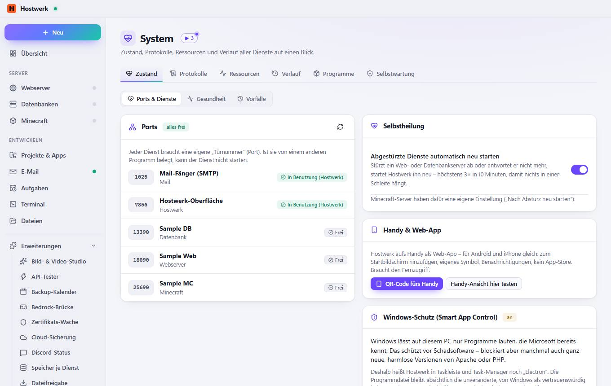
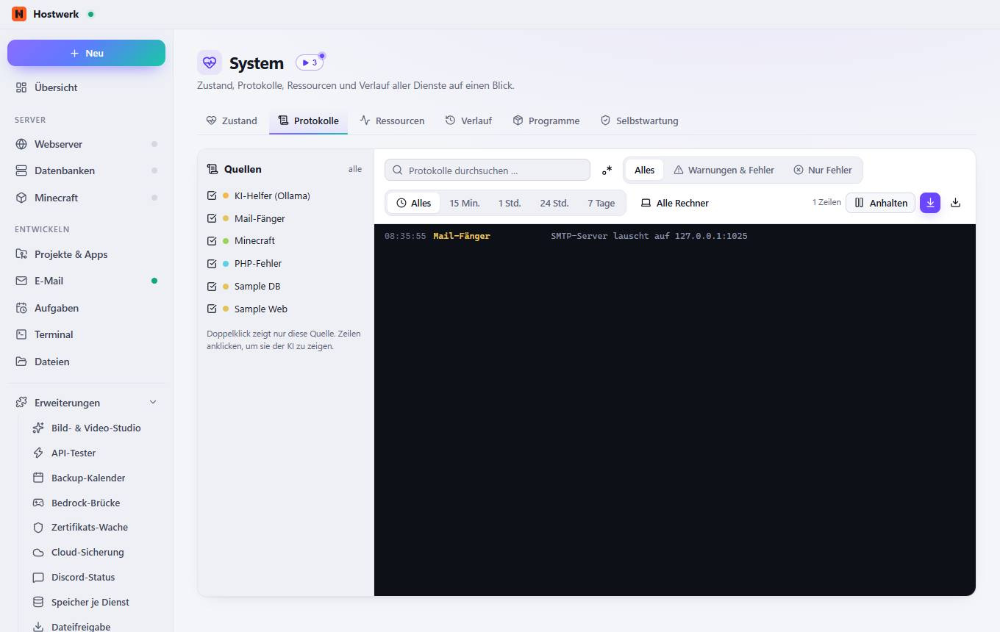
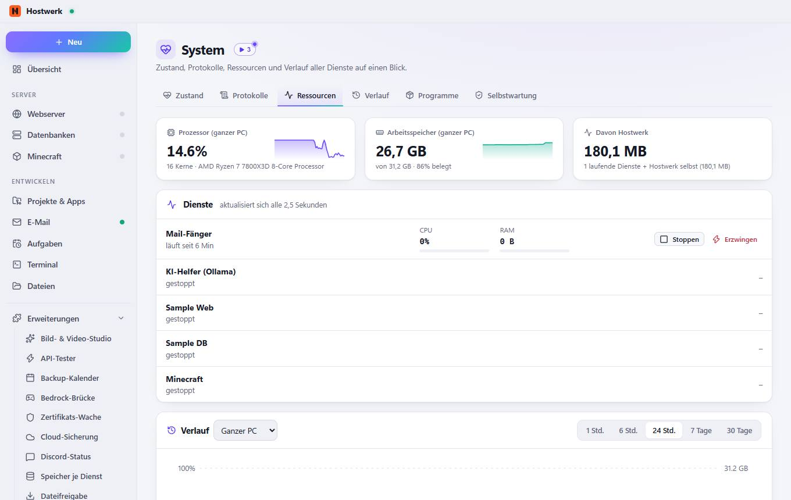
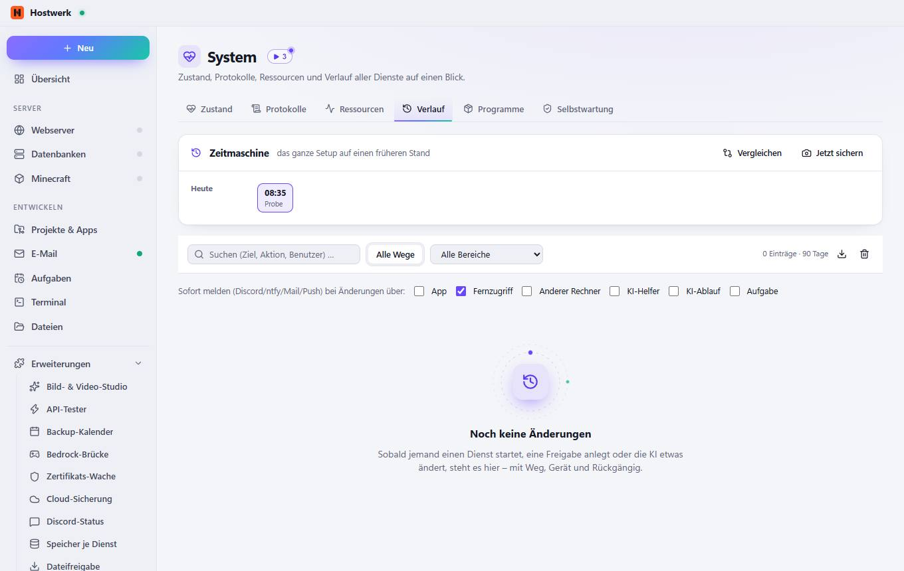
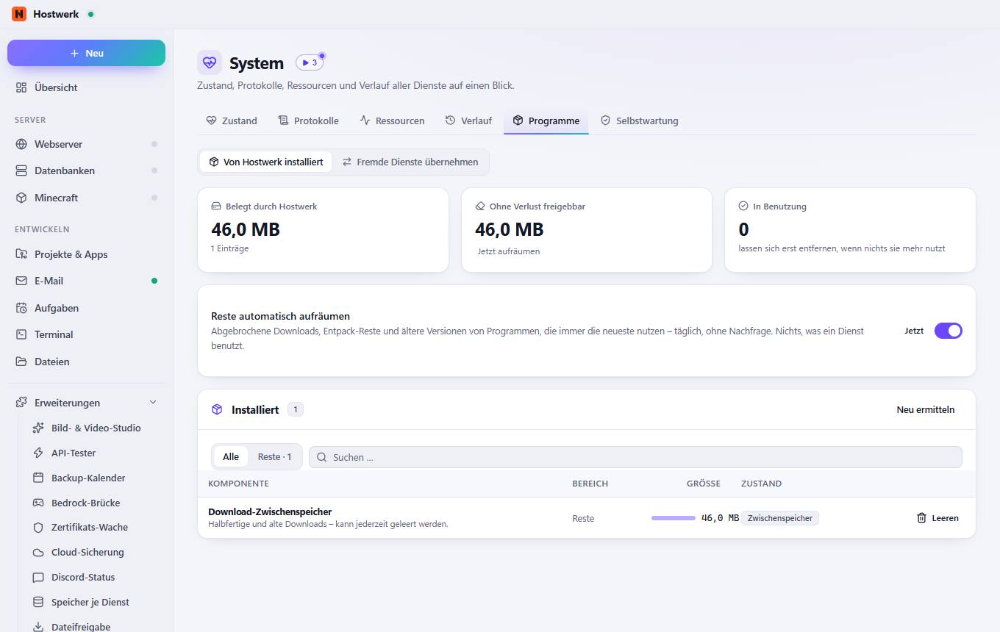
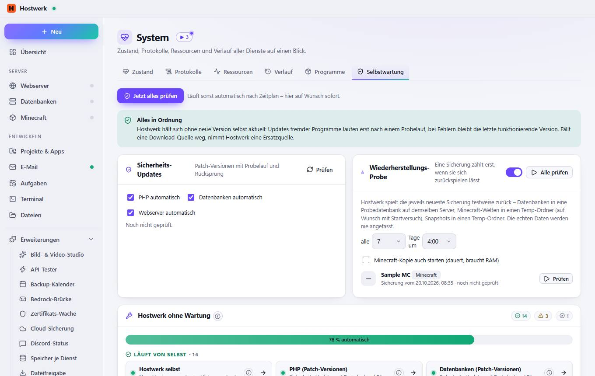

# System

[← Zurück zur Übersicht](README.md)

Zustand, Protokolle, Ressourcen und Verlauf aller Dienste auf einen Blick.

### Bereiche auf dieser Seite

- Ports
- Selbstheilung
- Handy & Web-App
- Windows-Schutz (Smart App Control)
- Diagnosebericht

### Was du hier tun kannst

- Neu prüfen
- QR-Code fürs Handy
- Handy-Ansicht hier testen
- Gesamtbericht speichern

### Eingaben

- Abgestürzte Dienste automatisch neu starten

## Reiter

### Protokolle

**Was du hier tun kannst:** alle · Regulärer Ausdruck · Alle Rechner · Anhalten · Automatisch nach unten scrollen · Als Textdatei speichern

### Ressourcen

**Bereiche auf dieser Seite:** Dienste · Verlauf

**Was du hier tun kannst:** Stoppen · Erzwingen

### Verlauf

**Bereiche auf dieser Seite:** Zeitmaschine

**Was du hier tun kannst:** Vergleichen · Jetzt sichern · 08:35 Probe · Als CSV speichern · Protokoll leeren

### Programme

**Bereiche auf dieser Seite:** Installiert

**Was du hier tun kannst:** Jetzt aufräumen · Jetzt · Neu ermitteln · Leeren

### Selbstwartung

> Was heißt „ohne Wartung“? Hostwerk hält sich und deine Dienste selbst aktuell: Updates mit Probelauf und Rückweg, Erneuerungen, Aufräumen, Neustart nach Abstürzen. Hier siehst du je Bereich, ob das schon von allein läuft – ein Klick auf ⓘ erklärt, was genau passiert und was dir bleibt.
> Hostwerk selbst Hostwerk prüft täglich auf neue Versionen, lädt sie im Hintergrund und tauscht sie beim nächsten Start aus. Startet die neue Version nicht sauber, läuft automatisch die vorherige weiter. Was du tun kannst: Nichts – außer du willst Versionen überspringen (Einstellungen → Updates).
> PHP (Patch-Versionen) Alle 6 Stunden schaut Hostwerk nach Sicherheits-Updates innerhalb deiner PHP-Reihe (z. B. 8.3.x). Die neue Version wird neben der alten installiert, mit einem Probelauf getestet und erst dann aktiv. Scheitert der Test, bleibt die alte. Was du tun kannst: Größere Sprünge (8.3 → 8.4) entscheidest du selbst – Hostwerk schlägt sie nur vor.
> Datenbanken (Patch-Versionen) Wie bei PHP: Patch-Versionen von MariaDB, MySQL und PostgreSQL werden geprüft, mit Probelauf eingespielt, bei Fehlern zurückgerollt. Was du tun kannst: Hauptversionen wechselst du selbst im Datenbank-Bereich.
> Webserver (Patch-Versionen) Apache, nginx und Caddy bekommen Sicherheits-Updates ihrer Reihe – mit Probelauf, die alte Version bleibt als Rückweg liegen. Was du tun kannst: Nichts.
> Geyser/Floodgate Geyser und Floodgate (Bedrock-Spieler) werden automatisch aktualisiert und getestet. Was du tun kannst: Nichts.
> Zertifikate (Let’s Encrypt, lokale CA) HTTPS-Zertifikate (Let’s Encrypt und Hostwerks lokale Zertifizierungsstelle) werden rechtzeitig erneuert. Was du tun kannst: Nichts – bei einem Fehler meldet sich Hostwerk.
> KI-Programme und Modelle Ollama, Bildmodelle, Spracherkennung und Stimmen werden mit Probelauf aktualisiert; die Modellkataloge kommen täglich online. Was du tun kannst: Ist die KI abgeschaltet, gibt es hier nichts zu tun.
> Laufzeit (Node/Electron) Node.js und Electron, auf denen Hostwerk läuft, werden mit dem App-Update getauscht – nach einem Selbsttest. Was du tun kannst: Nichts.
> Wiederherstellungs-Probe Regelmäßig wird die neueste Sicherung in eine Wegwerf-Umgebung zurückgespielt und geprüft. So fällt eine kaputte Sicherung auf, bevor man sie braucht. Was du tun kannst: Nichts.
> Aufräumen (Reste, Cache, Papierkorb) Täglich räumt Hostwerk Installationsreste und alte Downloads auf; der Papierkorb wird nach 30 Tagen geleert. Was du tun kannst: Nichts.
> Selbstheilung (Dienste neu starten) Stürzt ein Dienst ab oder antwortet nicht mehr, startet Hostwerk ihn neu (mit Pause, damit er nicht endlos neu startet). Was du tun kannst: Nichts – Vorfälle stehen unter System → Vorfälle.

**Bereiche auf dieser Seite:** Sicherheits-Updates · Wiederherstellungs-Probe · Hostwerk ohne Wartung · Monatlicher Wartungs-Lauf · Online-Kataloge

**Was du hier tun kannst:** Jetzt alles prüfen · Prüfen · Alle prüfen · Bereich öffnen · Startzeit Server bereit nach 0,7 s 20.10.26, 08:35

Erzeugt am 2026-10-20 · Hostwerk 2.10.0
