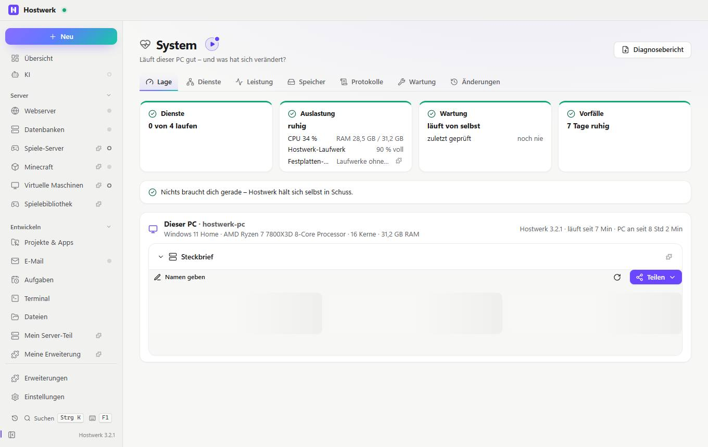
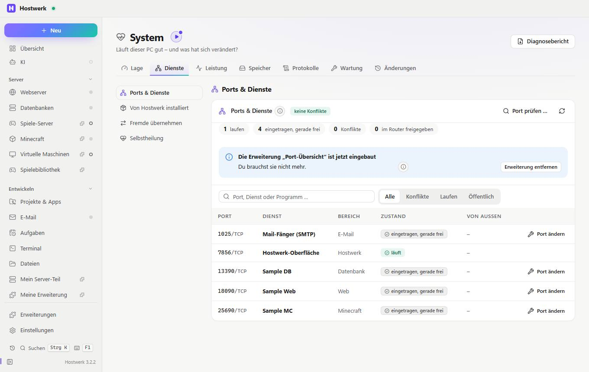
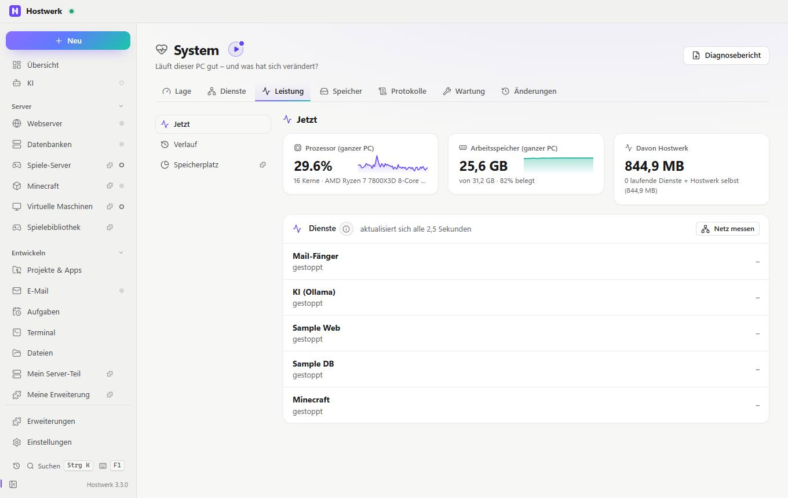
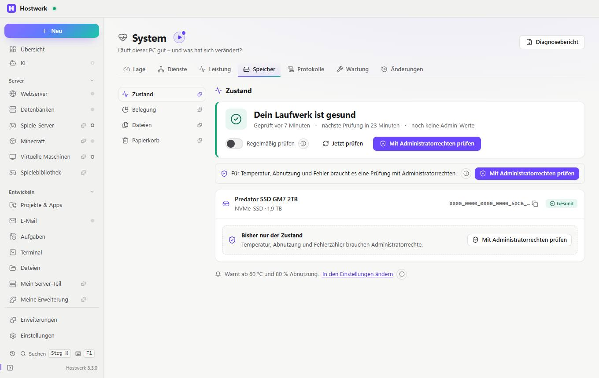
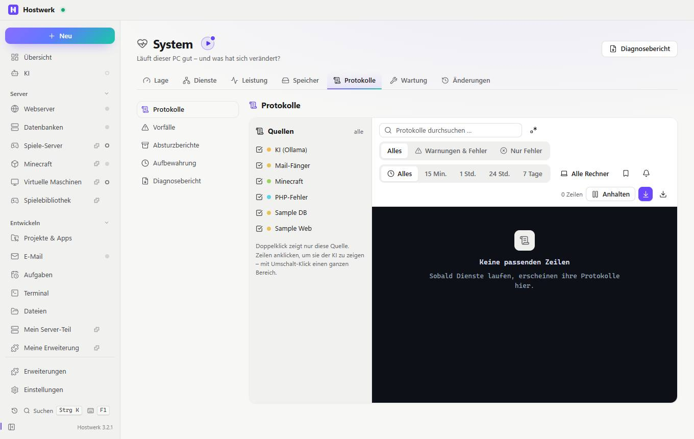
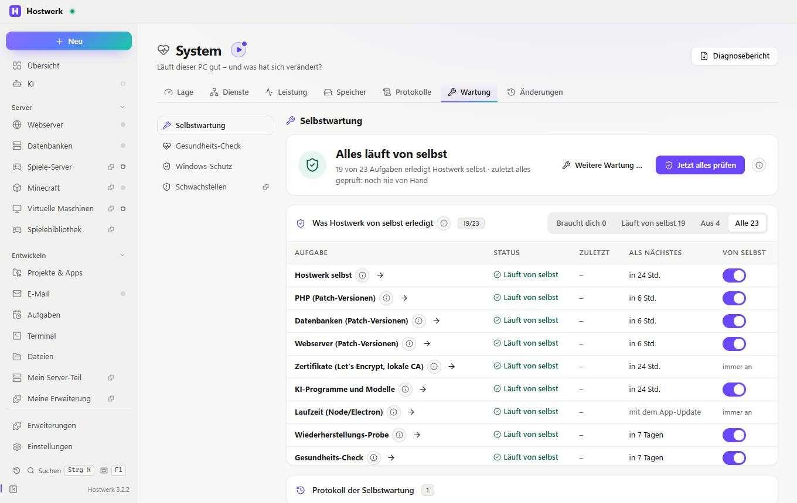
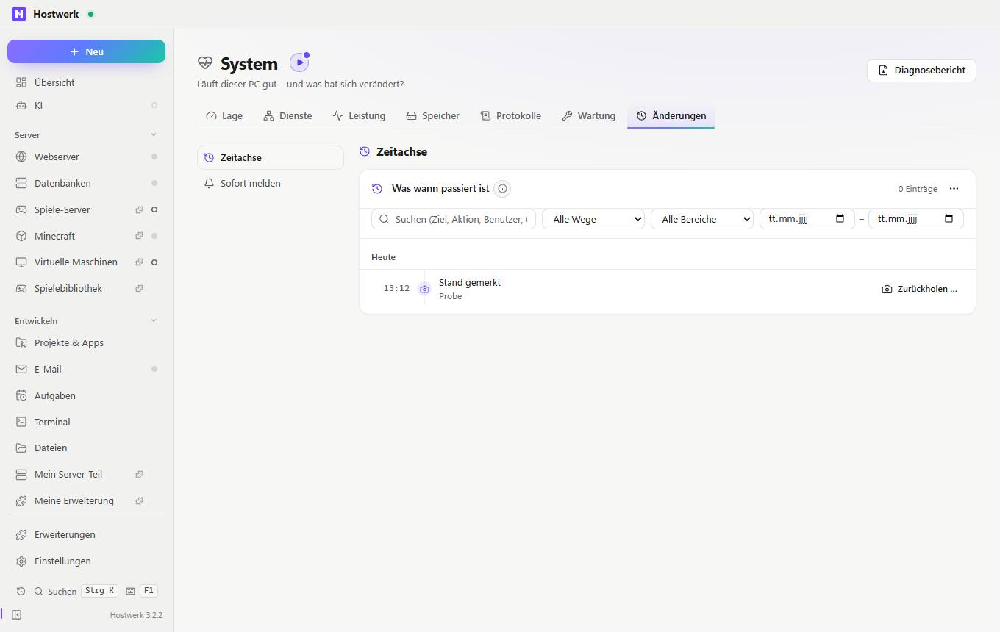

# System

[← Zurück zur Übersicht](README.md)

Läuft dieser PC gut – und was hat sich verändert?

### Bereiche auf dieser Seite

- Steckbrief

### Was du hier tun kannst

- 3 Videos
- Diagnosebericht
- Von der Erweiterung „disk-health“ – Infos
- Steckbrief
- Von der Erweiterung „Server-Steckbrief“ – Infos

## Reiter

### Dienste

> Jeder Dienst braucht eine eigene „Türnummer“ (Port). Ist sie von einem anderen Programm belegt oder wollen zwei Dienste dieselbe, kann einer nicht starten. „Port ändern“ gibt einem gestoppten Dienst einen wirklich freien Port – auf Wunsch einen bestimmten. Rechtsklick auf eine Zeile für mehr.
> Port-Übersicht Alles, was sie konnte, steht hier. Die Erweiterung brauchst du nicht mehr – entfernen ist sicher, Hostwerk-Dienste und Ports bleiben unverändert.

**Bereiche auf dieser Seite:** Ports & Dienste

**Was du hier tun kannst:** 3 Videos · Diagnosebericht · Port prüfen … · Neu prüfen · Erweiterung entfernen · Port ändern

### Leistung

> Datenträger und Netz Datenträger: Windows zählt hier alle Ein- und Ausgaben des Programms – Dateien, aber auch Netz und Geräte. Netz: braucht unter Windows Administratorrechte – mit „Netz messen“ richtest du das einmal ein.

**Bereiche auf dieser Seite:** Jetzt · Dienste

**Was du hier tun kannst:** 3 Videos · Diagnosebericht · Netz messen

### Speicher

> Laufwerke Hostwerk liest die S.M.A.R.T.-Werte jedes Laufwerks – Temperatur, Abnutzung, Fehler – und meldet sich, wenn etwas schlechter wird, und zeigt, wie voll das Laufwerk ist und wer den Platz belegt. An den Laufwerken wird nie etwas verändert.
> Regelmäßig mit Administratorrechten prüfen Hostwerk richtet eine Windows-Aufgabe ein, die die Werte stündlich mit Administratorrechten liest. Windows fragt dafür einmal nach. Die Aufgabe liest nur und entfernt sich selbst, wenn du die Erweiterung deinstallierst.
> Warum Administratorrechte? Ohne Administratorrechte zeigt Windows nur, ob ein Laufwerk gesund ist. Temperatur, Abnutzung und Fehlerzähler liest eine einzige Prüfung – Windows fragt dafür einmal nach. Hostwerk selbst läuft weiter ohne Administratorrechte.
> Benachrichtigungen Warnungen gehen an Hostwerks Benachrichtigungen (Push, Discord, ntfy, Mail) und stehen unter Livebetrieb → Überwachung → Wächter.

**Bereiche auf dieser Seite:** Laufwerke · Predator SSD GM7 2TB

**Was du hier tun kannst:** 3 Videos · Diagnosebericht · Laufwerke · Von der Erweiterung „Laufwerke“ – Infos · Jetzt prüfen · Mit Administratorrechten prüfen · 0000_0000_0000_0000_50C6_8E52_7150_2160

### Protokolle

**Bereiche auf dieser Seite:** Protokolle

**Was du hier tun kannst:** 3 Videos · Diagnosebericht · alle · Regulärer Ausdruck · Alle Rechner · Filter merken · Protokoll-Wächter · Anhalten · Automatisch nach unten scrollen · Als Textdatei speichern

### Wartung

> Hostwerk hält sich ohne neue Version selbst aktuell: Updates fremder Programme laufen erst nach einem Probelauf, bei Fehlern bleibt die letzte funktionierende Version. Fällt eine Download-Quelle weg, nimmt Hostwerk eine Ersatzquelle. „Jetzt alles prüfen“ stößt alle Prüfungen sofort an (bis zu einer Minute) – sonst laufen sie nach Zeitplan.
> Je Aufgabe: ob sie gerade von selbst läuft, wann zuletzt etwas passiert ist und wann ungefähr als Nächstes. Der Schalter ist derselbe wie in den Einstellungen. Das ⓘ je Zeile erklärt, was genau passiert und was du selbst tun kannst.
> Hostwerk selbst Neue Versionen werden im Hintergrund geladen und beim nächsten Start aktiv (inkl. Laufzeit). Hostwerk prüft täglich auf neue Versionen, lädt sie im Hintergrund und tauscht sie beim nächsten Start aus. Startet die neue Version nicht sauber, läuft automatisch die vorherige weiter. Was du tun kannst: Nichts – außer du willst Versionen überspringen (Einstellungen → Updates).
> PHP (Patch-Versionen) Sicherheits-Updates mit Probelauf und Rücksprung. Alle 6 Stunden schaut Hostwerk nach Sicherheits-Updates innerhalb deiner PHP-Reihe (z. B. 8.3.x). Die neue Version wird neben der alten installiert, mit einem Probelauf getestet und erst dann aktiv. Scheitert der Test, bleibt die alte. Was du tun kannst: Größere Sprünge (8.3 → 8.4) entscheidest du selbst – Hostwerk schlägt sie nur vor.
> Datenbanken (Patch-Versionen) Sicherheits-Updates mit Probelauf und Rücksprung. Wie bei PHP: Patch-Versionen von MariaDB, MySQL und PostgreSQL werden geprüft, mit Probelauf eingespielt, bei Fehlern zurückgerollt. Was du tun kannst: Hauptversionen wechselst du selbst im Datenbank-Bereich.
> Webserver (Patch-Versionen) Sicherheits-Updates mit Probelauf. Apache, nginx und Caddy bekommen Sicherheits-Updates ihrer Reihe – mit Probelauf, die alte Version bleibt als Rückweg liegen. Was du tun kannst: Nichts.
> Zertifikate (Let’s Encrypt, lokale CA) Erneuerung nach 1/3 Laufzeit bzw. bei Ablauf. HTTPS-Zertifikate (Let’s Encrypt und Hostwerks lokale Zertifizierungsstelle) werden rechtzeitig erneuert. Was du tun kannst: Nichts – bei einem Fehler meldet sich Hostwerk.
> KI-Programme und Modelle Ollama, sd.cpp, whisper, Pocket TTS und Modelle mit Probelauf; Kataloge täglich. Ollama, Bildmodelle, Spracherkennung und Stimmen werden mit Probelauf aktualisiert; die Modellkataloge kommen täglich online. Was du tun kannst: Ist die KI abgeschaltet, gibt es hier nichts zu tun.
> Laufzeit (Node/Electron) Selbsttest vor dem Tausch, Rücksprung bei Fehler. Node.js und Electron, auf denen Hostwerk läuft, werden mit dem App-Update getauscht – nach einem Selbsttest. Was du tun kannst: Nichts.
> Wiederherstellungs-Probe Alle 7 Tage testweise zurückspielen. Regelmäßig wird die neueste Sicherung in eine Wegwerf-Umgebung zurückgespielt und geprüft. So fällt eine kaputte Sicherung auf, bevor man sie braucht. Was du tun kannst: Nichts.
> Gesundheits-Check Wöchentlicher Bericht über alle Rechner mit Ablauf-Vorschlägen. Ein Bericht über alle Rechner: Dienste, Sicherungen, Zertifikate, Speicher, Betriebssystem-Updates – mit Punktzahl und Vorschlägen. Was du tun kannst: Zeitplan einschalten (täglich, wöchentlich oder monatlich) oder bei Bedarf „Jetzt prüfen“.
> Aufräumen (Reste, Cache, Papierkorb) Täglich: Installationsreste, alte Downloads, Papierkorb nach 30 Tagen. Täglich räumt Hostwerk Installationsreste und alte Downloads auf; der Papierkorb wird nach 30 Tagen geleert. Was du tun kannst: Nichts.

**Bereiche auf dieser Seite:** Selbstwartung · Was Hostwerk von selbst erledigt · Protokoll der Selbstwartung

**Was du hier tun kannst:** 3 Videos · Diagnosebericht · Weitere Wartung … · Jetzt alles prüfen · Bereich öffnen: Hostwerk selbst · Bereich öffnen: PHP (Patch-Versionen) · Bereich öffnen: Datenbanken (Patch-Versionen) · Bereich öffnen: Webserver (Patch-Versionen) · Bereich öffnen: Zertifikate (Let’s Encrypt, lokale CA) · Bereich öffnen: KI-Programme und Modelle · Bereich öffnen: Laufzeit (Node/Electron) · Bereich öffnen: Wiederherstellungs-Probe · Bereich öffnen: Gesundheits-Check · Bereich öffnen: Aufräumen (Reste, Cache, Papierkorb) · Bereich öffnen: Selbstheilung (Dienste neu starten) · Bereich öffnen: Download-Quellen · Bereich öffnen: Protokolle · Bereich öffnen: Speicherplatz · Bereich öffnen: Erweiterungen · Bereich öffnen: Docker-Engine und Images · Bereich öffnen: Signatur / Windows-App (MSIX) · Bereich öffnen: Geyser/Floodgate · Bereich öffnen: Router-Freigaben & DynDNS · Bereich öffnen: Sicherungen · Bereich öffnen: Lebensende von Versionen · Bereich öffnen: Minecraft-Plugins/Mods · Bereich öffnen: Betriebssystem-Updates

### Änderungen

> Jede Änderung an Diensten, Freigaben, Einstellungen – egal ob in der App, über den Fernzugriff, von einem anderen Rechner, der KI oder einer Aufgabe. Einträge mit „Rückgängig“ lassen sich einzeln zurücknehmen. Das Kamera-Symbol markiert einen Stand, zu dem du unter Sicherungen → Zurückholen zurückkehren kannst. Aufbewahrt werden 90 Tage.

**Bereiche auf dieser Seite:** Zeitachse · Was wann passiert ist

**Was du hier tun kannst:** 3 Videos · Diagnosebericht · Weitere Aktionen · Zurückholen …

Erzeugt am 2026-11-18 · Hostwerk 3.2.1
