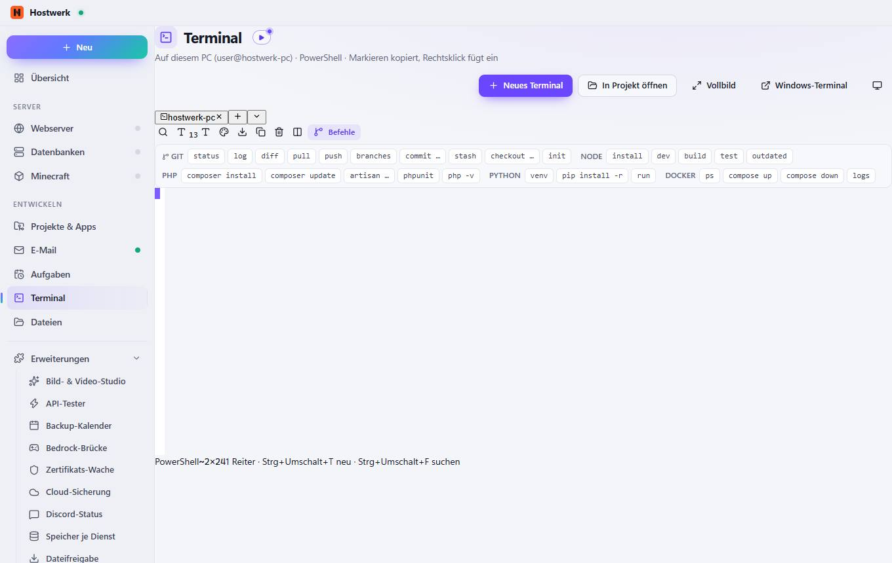

# Terminal

[← Zurück zur Übersicht](README.md)

Auf diesem PC (user@hostwerk-pc) · PowerShell · Markieren kopiert, Rechtsklick fügt ein

### Was du hier tun kannst

- Kurz erklärt: Terminal (45 Sekunden)
- Neues Terminal
- In Projekt öffnen
- Vollbild
- Windows-Terminal
- Terminal auf einem anderen Rechner
- hostwerk-pc
- Neues Terminal (PowerShell) · Strg+Umschalt+T
- Andere Shell wählen
- Suchen (Strg+Umschalt+F)
- Schrift kleiner
- Schrift größer
- Farbschema: Hostwerk – klicken zum Wechseln
- Mitschnitt als Textdatei speichern
- Markiertes kopieren
- Anzeige leeren
- Teilen (zweites Terminal daneben)
- Befehle
- status
- log
- diff
- pull
- push
- branches
- commit …
- stash
- checkout …
- init
- install
- dev
- build
- test
- outdated
- composer install
- composer update
- artisan …
- phpunit
- php -v
- venv
- pip install -r

Erzeugt am 2026-10-20 · Hostwerk 2.10.0
