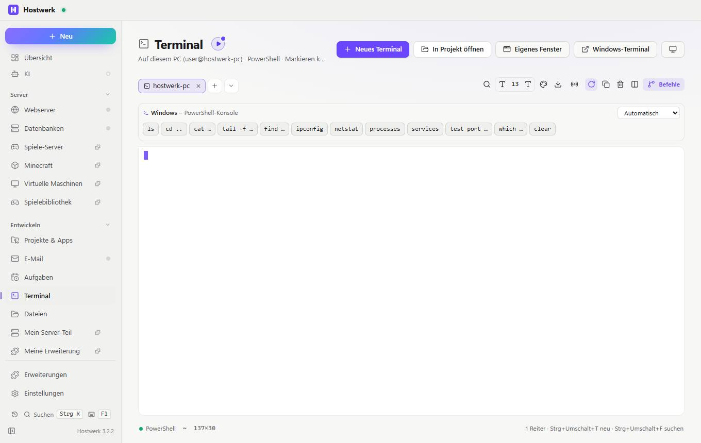

# Terminal

[← Zurück zur Übersicht](README.md)

Auf diesem PC (user@hostwerk-pc) · PowerShell · Markieren kopiert, Rechtsklick fügt ein

### Was du hier tun kannst

- Video
- Neues Terminal
- In Projekt öffnen
- Eigenes Fenster
- Windows-Terminal
- Terminal auf einem anderen Rechner
- hostwerk-pc
- Terminal „hostwerk-pc“ schließen
- Neues Terminal (PowerShell) · Strg+Umschalt+T
- Andere Shell wählen
- Suchen (Strg+Umschalt+F)
- Schrift kleiner
- Schrift größer
- Farbschema: Hostwerk – klicken zum Wechseln
- Mitschnitt als Textdatei speichern
- Eingabe an mehrere Reiter senden (z. B. für mehrere Server gleichzeitig)
- Sitzung wird beim nächsten Öffnen wiederhergestellt – klicken zum Ausschalten
- Markiertes kopieren
- Anzeige leeren
- Teilen (zweites Terminal daneben)
- Befehle
- ls
- cd ..
- cat …
- tail -f …
- find …
- ipconfig
- netstat
- processes
- services
- test port …
- which …
- clear

Erzeugt am 2026-11-20 · Hostwerk 3.3.0
