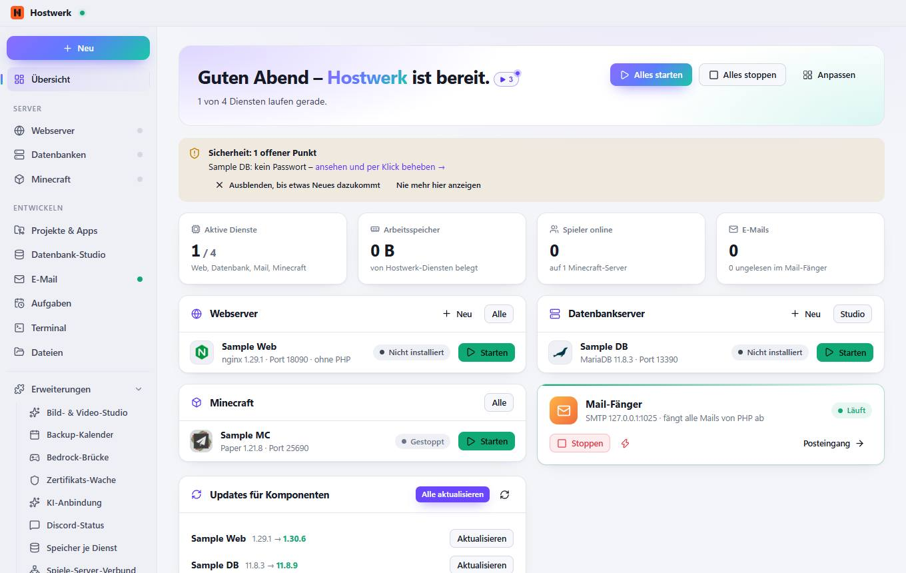

# Übersicht

[← Zurück zur Übersicht](README.md)

### Bereiche auf dieser Seite

- Webserver
- Datenbankserver
- Minecraft
- Updates für Komponenten

### Was du hier tun kannst

- Alles starten
- Alles stoppen
- Anpassen
- Ausblenden, bis etwas Neues dazukommt
- Nie mehr hier anzeigen
- Neu
- Alle
- Bild ändern
- Starten
- Studio
- Stoppen
- Sofort beenden (erzwingen)
- Posteingang
- Alle aktualisieren
- Erneut prüfen
- Aktualisieren

Erzeugt am 2026-10-19 · Hostwerk 2.9.0
