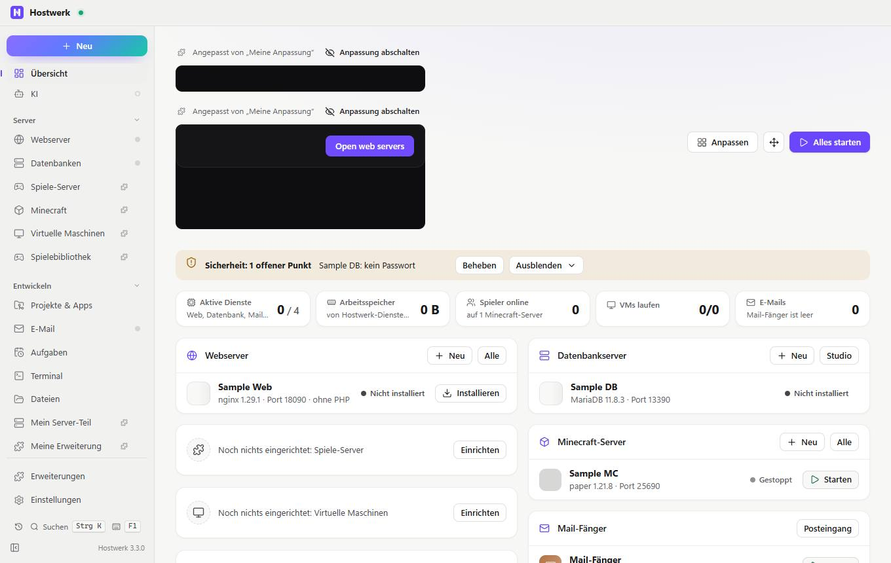

# Übersicht

[← Zurück zur Übersicht](README.md)

### Bereiche auf dieser Seite

- Webserver
- Datenbankserver
- Minecraft-Server
- Mail-Fänger
- Updates für Komponenten

### Was du hier tun kannst

- Von der Erweiterung „Meine Anpassung“ – Infos
- Anpassung abschalten
- Anpassen
- Kacheln anordnen
- Alles starten
- Beheben
- Ausblenden
- Neu
- Alle
- Bild ändern
- Installieren
- Studio
- Einrichten
- Starten
- Posteingang
- Erneut prüfen

Erzeugt am 2026-11-20 · Hostwerk 3.3.0
