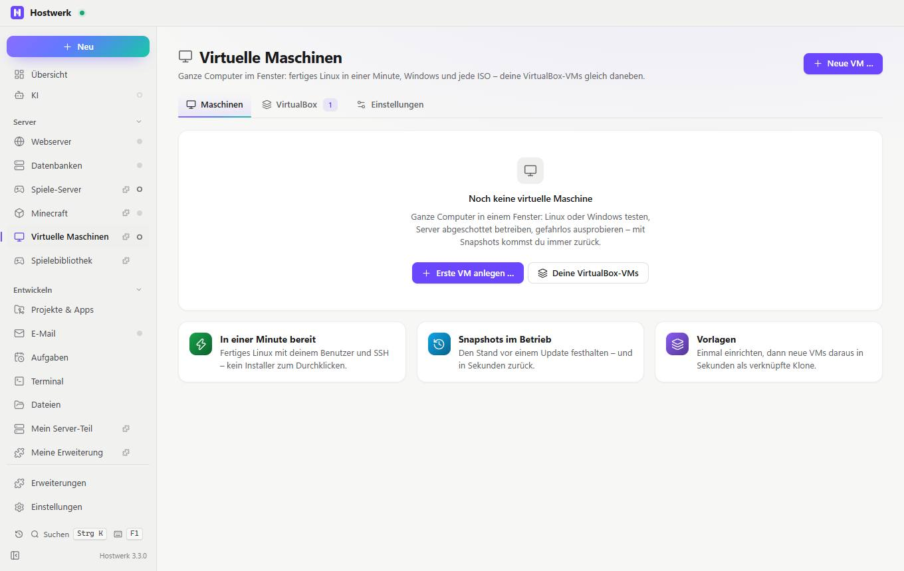
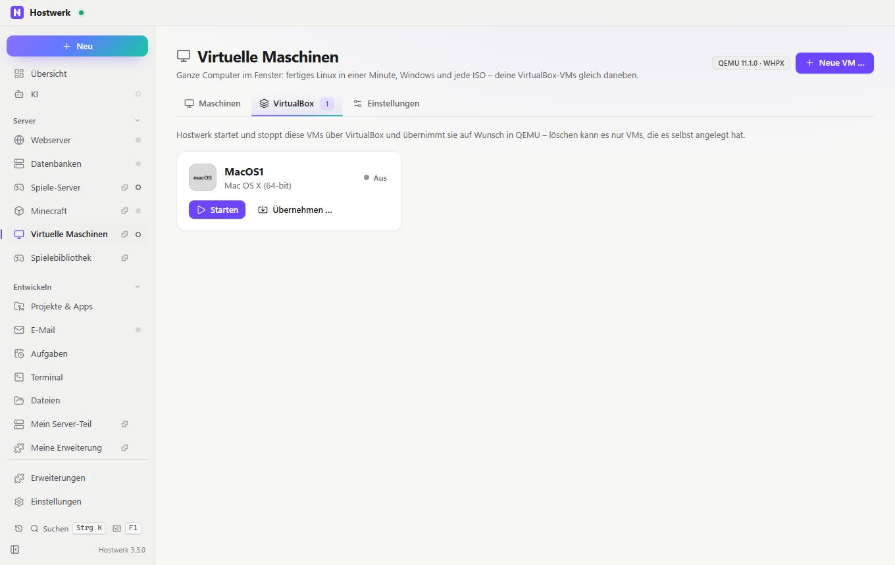
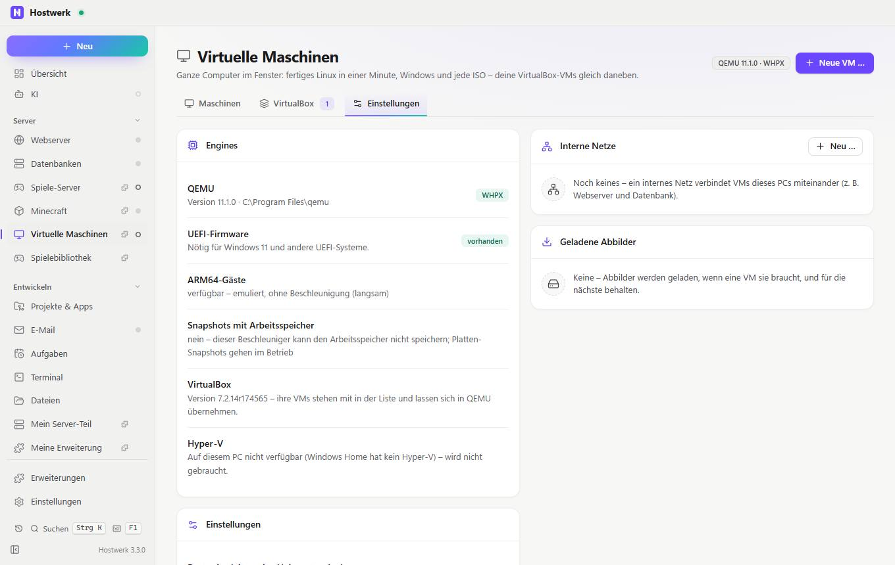

# Virtuelle Maschinen

[← Zurück zur Übersicht](README.md)

Ganze Computer im Fenster: fertiges Linux in einer Minute, Windows und jede ISO – deine VirtualBox-VMs gleich daneben.

### Was du hier tun kannst

- Neue VM …
- Erste VM anlegen …
- Deine VirtualBox-VMs

## Reiter

### VirtualBox

**Was du hier tun kannst:** Neue VM … · Bild ändern · Starten · Übernehmen …

### Einstellungen

**Bereiche auf dieser Seite:** Engines · Einstellungen · Interne Netze · Geladene Abbilder

**Was du hier tun kannst:** Neue VM … · Neu …

Erzeugt am 2026-11-20 · Hostwerk 3.3.0
