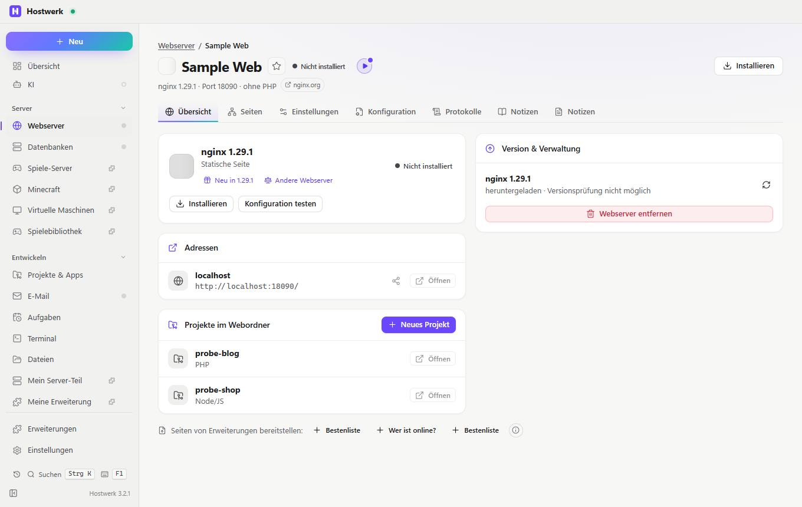
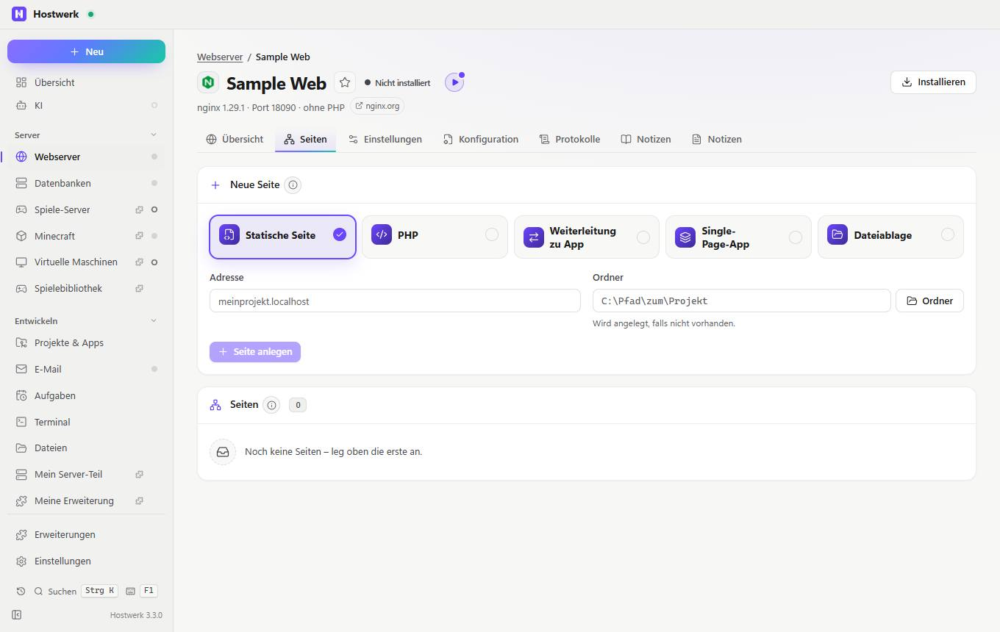
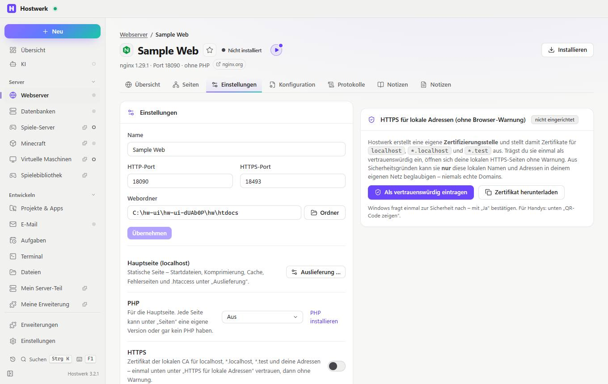
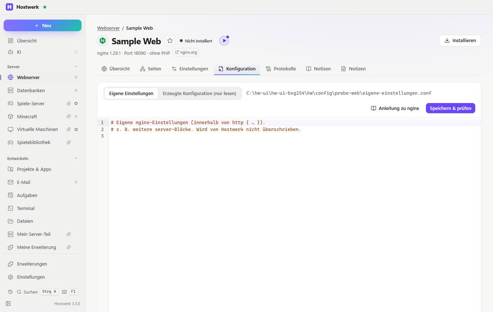
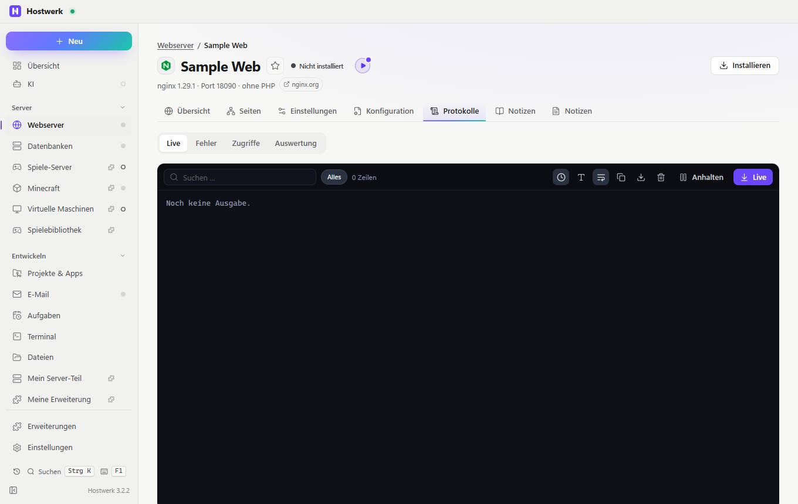
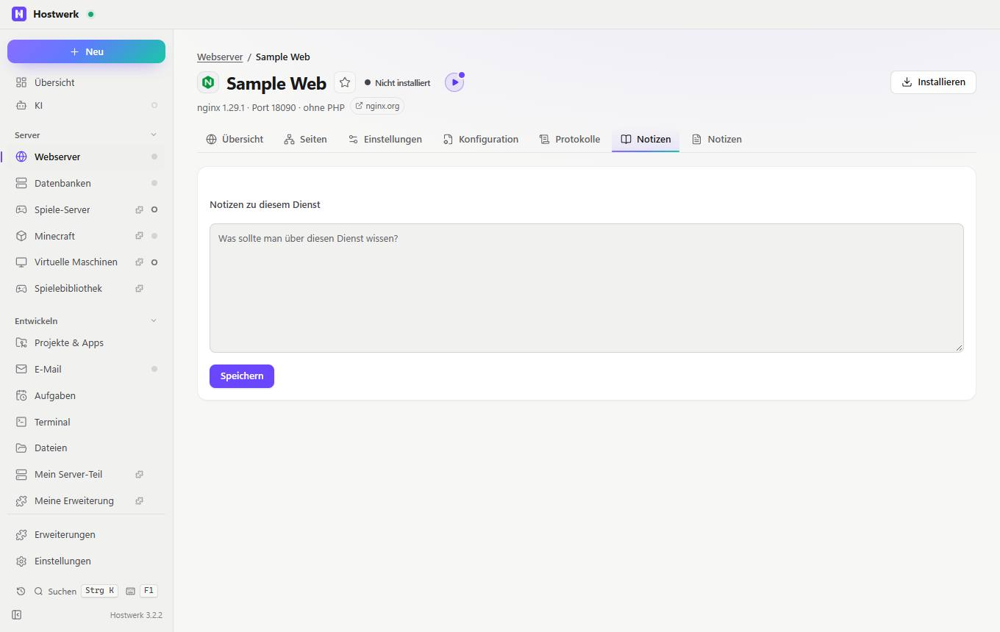

# Sample Web → Übersicht

[← Zurück zur Übersicht](README.md)

nginx 1.29.1 · Port 18090 · ohne PHP nginx.org

### Gut zu wissen

- Was ist das? Erweiterungen wie die Bestenliste können eine eigene Seite in diesen Webserver legen – Hostwerk schreibt sie in einen Unterordner und hält sie im gewählten Takt aktuell.

### Bereiche auf dieser Seite

- Adressen
- Projekte im Webordner
- Version & Verwaltung

### Was du hier tun kannst

- Bild ändern
- Als Favorit markieren (steht dann in Listen oben)
- 3 Videos
- nginx.org
- Installieren
- Neu in 1.29.1
- Andere Webserver
- Konfiguration testen
- Öffentlich teilen (Link fürs Internet)
- Öffnen
- Neues Projekt
- Webserver entfernen
- Bestenliste
- Wer ist online?

## Reiter

### Seiten

> Tipp: Adressen auf .localhost Adressen wie meinprojekt.localhost funktionieren in Chrome, Edge und Firefox ohne Eintrag in der hosts-Datei. Mit *.projekt.localhost landen alle Unteradressen bei derselben Seite.
> Jede Seite hat eine eigene Adresse auf diesem Server. Die Hauptseite (localhost) stellst du unter „Übersicht“ ein.

**Bereiche auf dieser Seite:** Neue Seite · Seiten

**Was du hier tun kannst:** Bild ändern · Als Favorit markieren (steht dann in Listen oben) · 3 Videos · nginx.org · Installieren · Statische Seite · PHP · Weiterleitung zu App · Single-Page-App · Dateiablage · Ordner · Seite anlegen

### Einstellungen

**Bereiche auf dieser Seite:** Einstellungen · HTTPS für lokale Adressen (ohne Browser-Warnung)

**Was du hier tun kannst:** Bild ändern · Als Favorit markieren (steht dann in Listen oben) · 3 Videos · nginx.org · Installieren · Ordner · Übernehmen · Auslieferung … · Als vertrauenswürdig eintragen · Zertifikat herunterladen

### Konfiguration

**Was du hier tun kannst:** Bild ändern · Als Favorit markieren (steht dann in Listen oben) · 3 Videos · nginx.org · Installieren · Anleitung zu nginx · Speichern & prüfen

### Protokolle

**Was du hier tun kannst:** Bild ändern · Als Favorit markieren (steht dann in Listen oben) · 3 Videos · nginx.org · Installieren · Alles · Uhrzeit anzeigen · Größere Schrift · Lange Zeilen umbrechen · Kopieren · Als Textdatei speichern · Leeren · Anhalten · Live

### Notizen

**Was du hier tun kannst:** Bild ändern · Als Favorit markieren (steht dann in Listen oben) · 3 Videos · nginx.org · Installieren

Erzeugt am 2026-11-18 · Hostwerk 3.2.1
