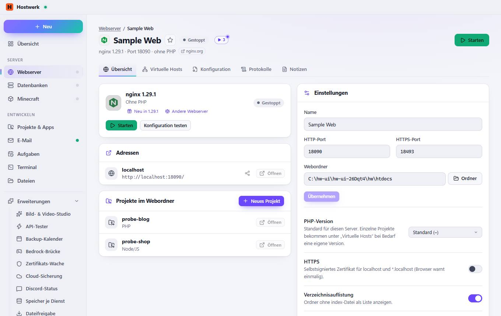
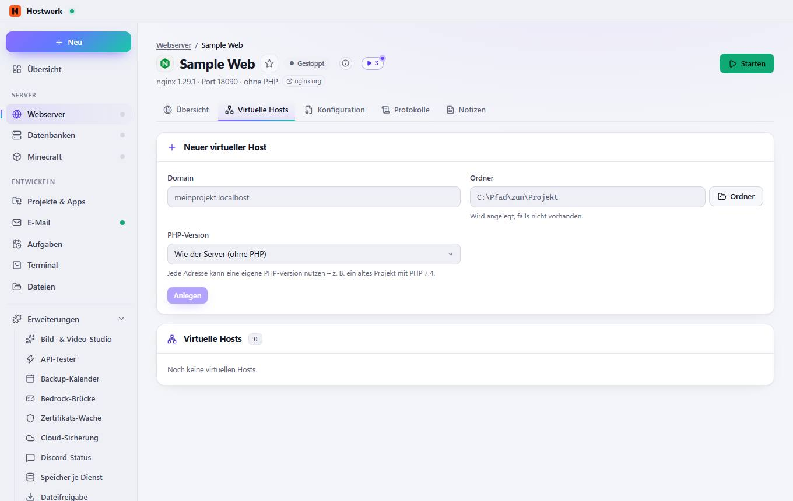
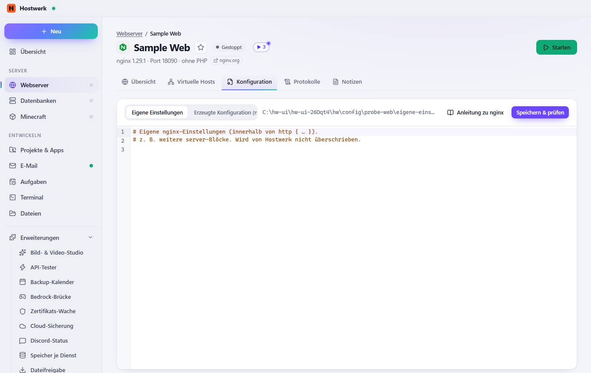
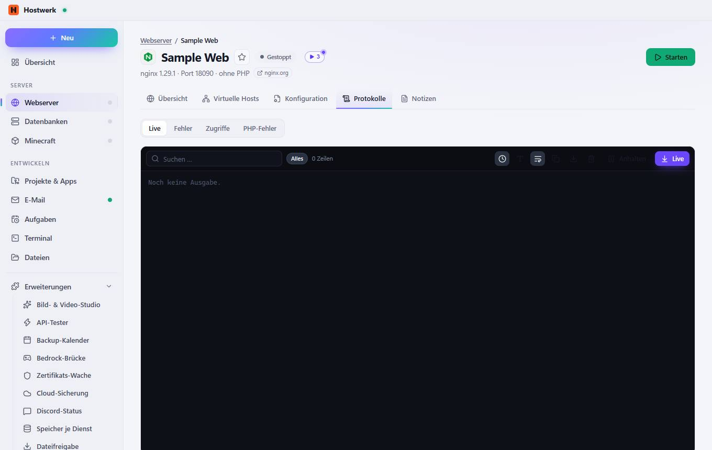
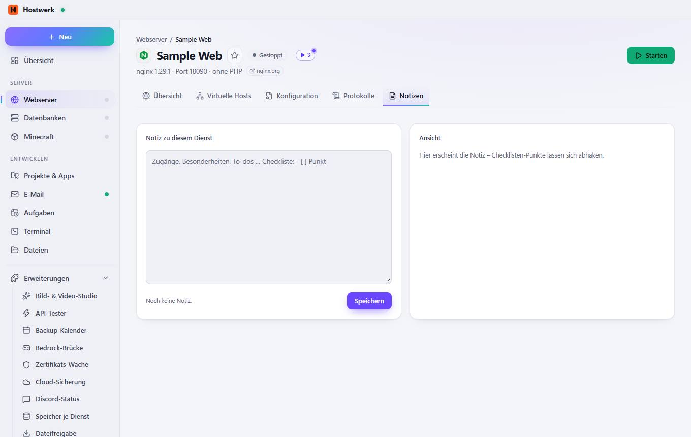

# Sample Web → Übersicht

[← Zurück zur Übersicht](README.md)

nginx 1.29.1 · Port 18090 · ohne PHP nginx.org

### Bereiche auf dieser Seite

- Adressen
- Projekte im Webordner
- Einstellungen
- Version & Verwaltung

### Was du hier tun kannst

- Bild ändern
- Als Favorit markieren (steht dann in Listen oben)
- nginx.org
- Starten
- Neu in 1.29.1
- Andere Webserver
- Konfiguration testen
- Öffentlich teilen (Link fürs Internet)
- Öffnen
- Neues Projekt
- Ordner
- Übernehmen
- Erneut prüfen
- Webserver entfernen

### Eingaben

- Name
- HTTP-Port
- HTTPS-Port
- Webordner
- PHP-Version
- HTTPS
- Verzeichnisauflistung
- Mit Hostwerk starten

## Reiter

### Virtuelle Hosts

> Tipp: Domains auf .localhost Adressen wie meinprojekt.localhost funktionieren in Chrome, Edge und Firefox ohne Eintrag in der hosts-Datei.

**Bereiche auf dieser Seite:** Neuer virtueller Host · Virtuelle Hosts

**Was du hier tun kannst:** Bild ändern · Als Favorit markieren (steht dann in Listen oben) · nginx.org · Starten · Ordner · Anlegen

### Konfiguration

**Was du hier tun kannst:** Bild ändern · Als Favorit markieren (steht dann in Listen oben) · nginx.org · Starten · Anleitung zu nginx · Speichern & prüfen

### Protokolle

**Was du hier tun kannst:** Bild ändern · Als Favorit markieren (steht dann in Listen oben) · nginx.org · Starten · Alles · Uhrzeit anzeigen · Größere Schrift · Lange Zeilen umbrechen · Kopieren · Als Textdatei speichern · Leeren · Anhalten · Live

### Notizen

**Was du hier tun kannst:** Bild ändern · Als Favorit markieren (steht dann in Listen oben) · nginx.org · Starten

Erzeugt am 2026-10-20 · Hostwerk 2.10.0
