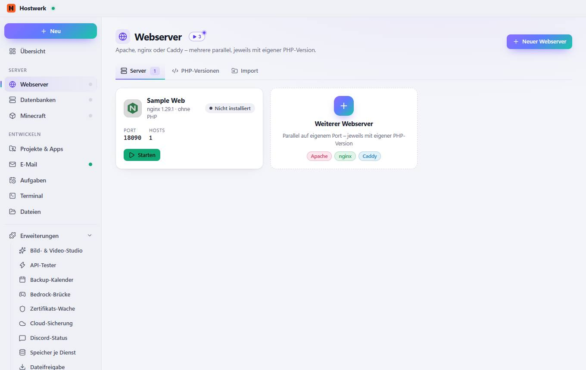
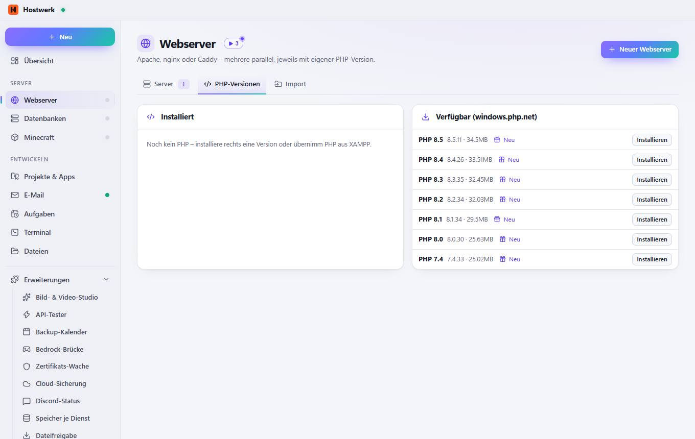
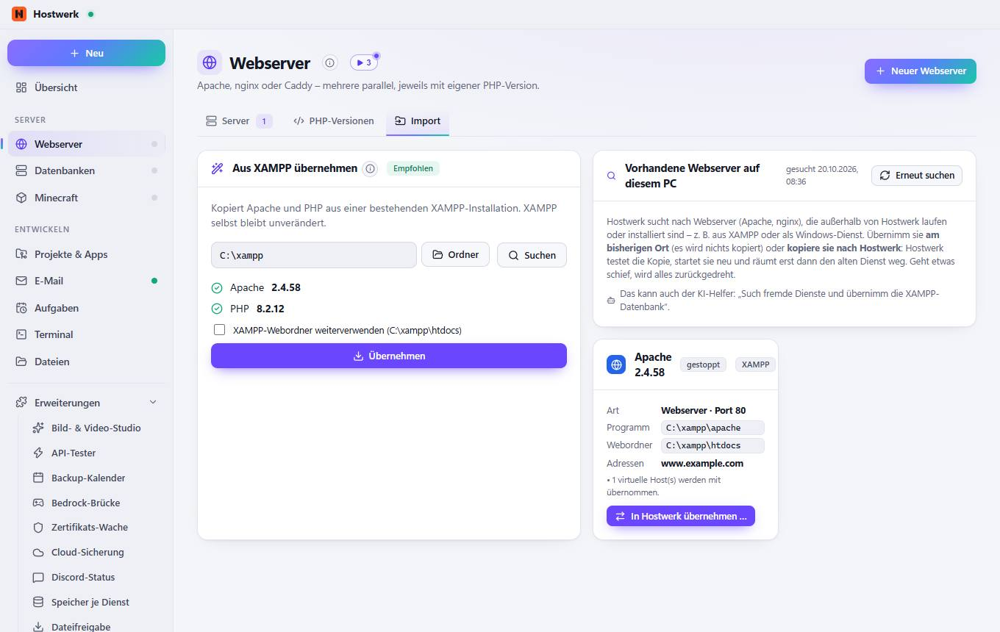

# Webserver

[← Zurück zur Übersicht](README.md)

Apache, nginx oder Caddy – mehrere parallel, jeweils mit eigener PHP-Version.

### Was du hier tun kannst

- Neuer Webserver
- Bild ändern
- Starten

## Reiter

### PHP-Versionen

**Bereiche auf dieser Seite:** Installiert · Verfügbar (windows.php.net)

**Was du hier tun kannst:** Neuer Webserver · Neu · Installieren

### Import

> Import – vorhandene Dienste übernehmen Läuft auf diesem PC schon ein Webserver – z. B. aus XAMPP oder als Windows-Dienst? Hostwerk übernimmt ihn: am bisherigen Ort (nichts wird verschoben) oder 1:1 kopiert, getestet und mit Rückweg. Dieselbe Suche gibt es für alle Arten unter System → Fremde Dienste.
> Smart App Control ist aktiv Windows lässt nur Programme mit bekannter „Reputation“ laufen. Ganz neue Apache- und PHP-Builds werden deshalb manchmal blockiert – die Versionen aus XAMPP sind bekannt und laufen sicher. Hostwerk prüft jede neue Version und behält sonst die alte; nginx, Caddy und die Datenbanken sind bisher nicht betroffen.

**Bereiche auf dieser Seite:** Aus XAMPP übernehmen · Vorhandene Webserver auf diesem PC · Apache 2.4.58

**Was du hier tun kannst:** Neuer Webserver · Ordner · Suchen · Übernehmen · Erneut suchen · In Hostwerk übernehmen …

Erzeugt am 2026-10-20 · Hostwerk 2.10.0
