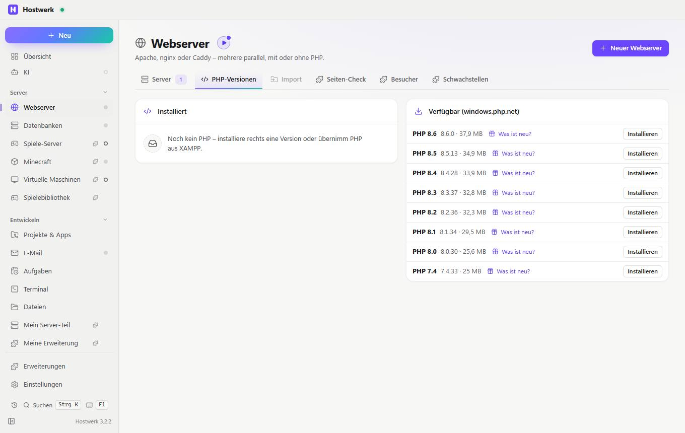
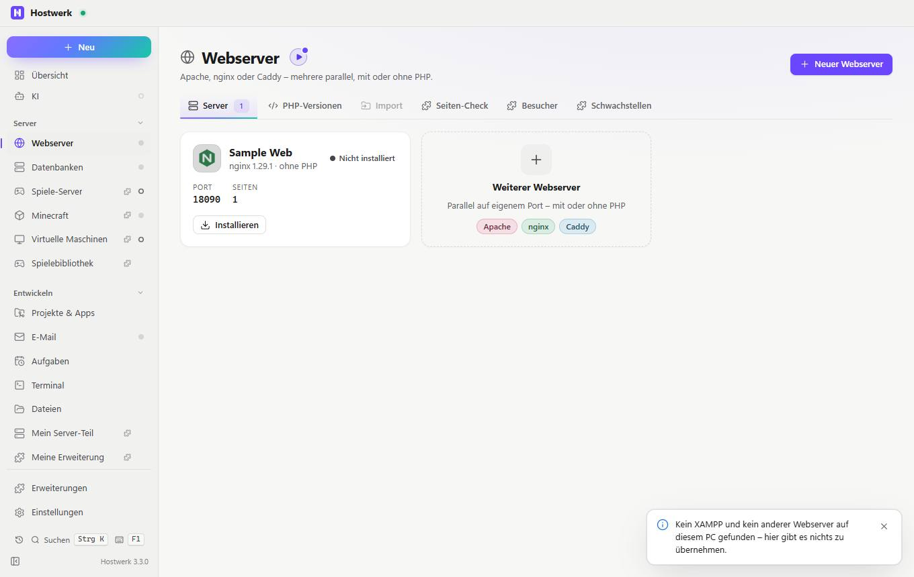
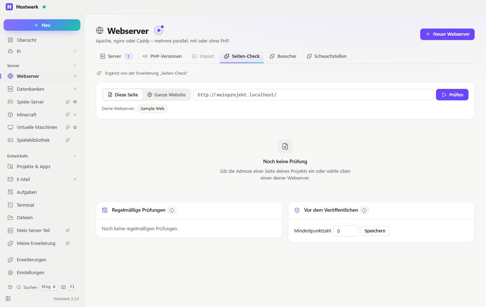
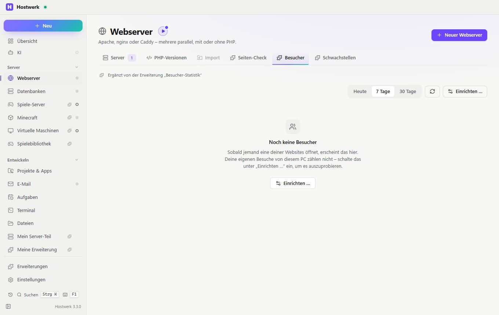
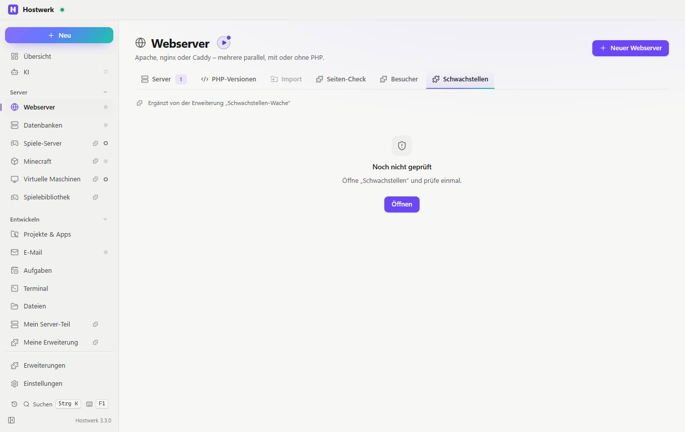

# Webserver

[← Zurück zur Übersicht](README.md)

Apache, nginx oder Caddy – mehrere parallel, mit oder ohne PHP.

### Was du hier tun kannst

- 3 Videos
- Neuer Webserver
- Bild ändern
- Installieren

## Reiter

### PHP-Versionen

**Bereiche auf dieser Seite:** Installiert · Verfügbar (windows.php.net)

**Was du hier tun kannst:** 3 Videos · Neuer Webserver · Was ist neu? · Installieren

### Import

**Was du hier tun kannst:** 3 Videos · Neuer Webserver · Bild ändern · Installieren

### Seiten-Check

> Regelmäßige Prüfungen Hostwerk prüft diese Adressen von selbst und meldet sich, wenn die Punktzahl um 5 oder mehr fällt.
> Mindestpunktzahl Erweiterungen zum Veröffentlichen (z. B. „Seiten veröffentlichen“) prüfen die Seite vorher und halten unter dieser Punktzahl an. 0 = aus.

**Bereiche auf dieser Seite:** Regelmäßige Prüfungen · Vor dem Veröffentlichen

**Was du hier tun kannst:** 3 Videos · Neuer Webserver · Von der Erweiterung „Seiten-Check“ – Infos · Prüfen · Sample Web · Speichern

### Besucher

> Datenschutz Keine Cookies, kein Fingerabdruck. IP-Adressen werden gekürzt (der letzte Teil fällt weg) und in einen Hash verwandelt, der sich jeden Tag ändert – nach zwei Tagen kann nicht einmal dieser PC Besuche miteinander verbinden. Bots, Crawler, Erreichbarkeits-Prüfungen, Bilder und Skripte bleiben draußen. Nichts verlässt diesen PC.

**Was du hier tun kannst:** 3 Videos · Neuer Webserver · Von der Erweiterung „Besucher-Statistik“ – Infos · Neue Protokollzeilen jetzt lesen · Einrichten …

### Schwachstellen

**Was du hier tun kannst:** 3 Videos · Neuer Webserver · Von der Erweiterung „Schwachstellen-Wache“ – Infos · Öffnen

Erzeugt am 2026-11-20 · Hostwerk 3.3.0
