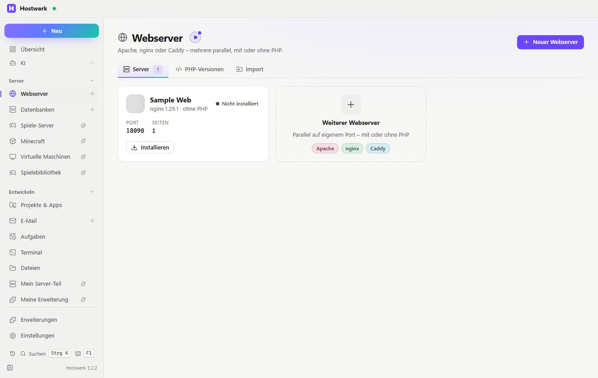

# Webserver

[← Zurück zur Übersicht](README.md)

Apache, nginx oder Caddy – mehrere parallel, mit oder ohne PHP.

### Was du hier tun kannst

- 3 Videos
- Neuer Webserver
- Bild ändern
- Installieren

## Reiter

### PHP-Versionen

**Bereiche auf dieser Seite:** Installiert · Verfügbar (windows.php.net)

**Was du hier tun kannst:** 3 Videos · Neuer Webserver · Was ist neu? · Installieren

### Import

**Was du hier tun kannst:** 3 Videos · Neuer Webserver · Bild ändern · Installieren

Erzeugt am 2026-11-18 · Hostwerk 3.2.1
