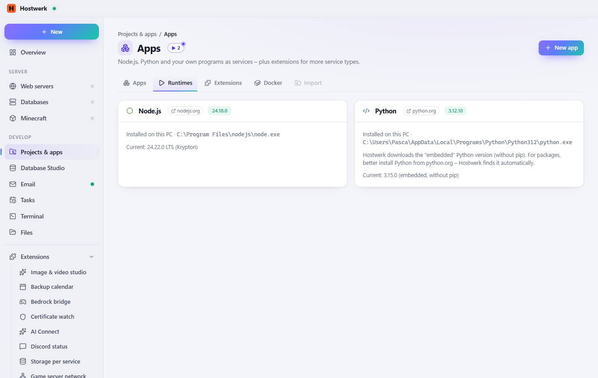
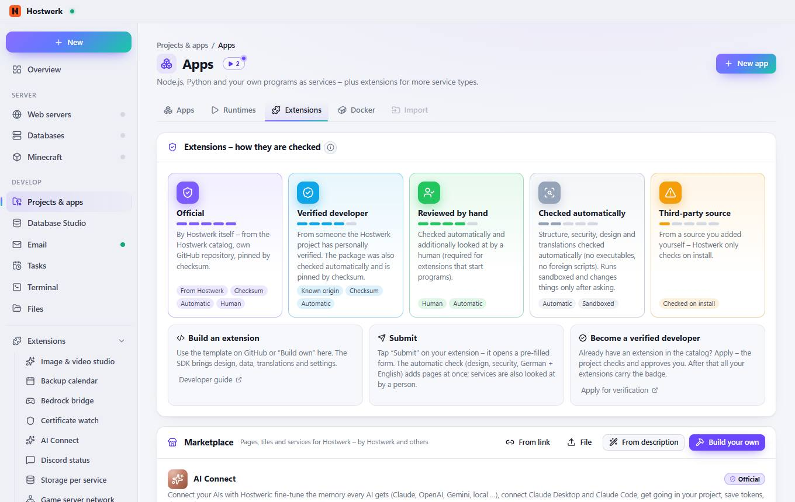
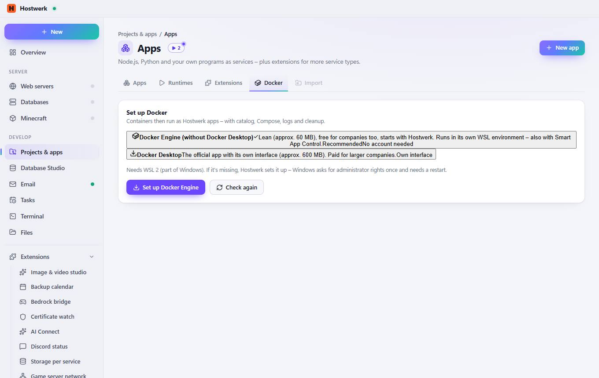
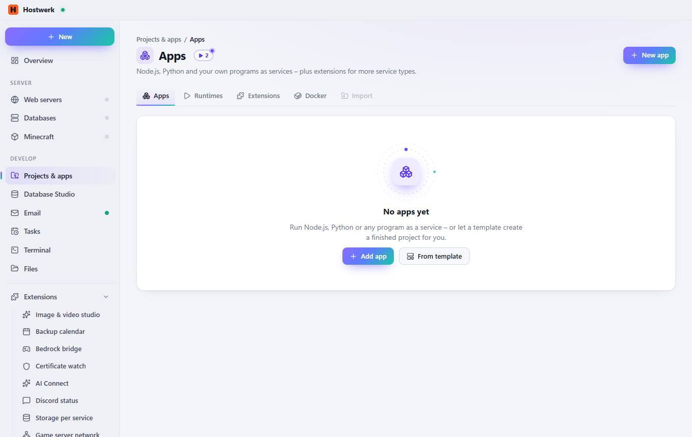

# Apps

[← Back to the overview](README.md)

Node.js, Python and your own programs as services – plus extensions for more service types.

### What you can do here

- New app
- Add app
- From template

## Tabs

### Runtimes

**Areas on this page:** Node.js · Python

**What you can do here:** New app · nodejs.org · python.org

### Extensions

> What is an extension? An extension adds its own page, a tile for the overview and/or its own service to Hostwerk. Pages run isolated (own origin, no access to your login), only see what their permissions allow and only change things after you confirm each time. Colors and fonts come from Hostwerk – so every extension fits the design.

**Areas on this page:** Extensions – how they are checked · Marketplace · Installed packages · For developers · Your extensions · Catalog · Build your own extension

**What you can do here:** New app · Developer guide · Apply for verification · From link · From description · Build your own · Rate · Source code · Add more catalogs (sources) · Open · Check (design, security, translations) · Access – what the extension read or changed · Keep building – the AI changes the extension the way you want · Export (ZIP) · Share (link) · Submit to the public catalog · Remove · Settings · Guide Step by step: package, SDK, design, permissions, translations, check, verification. · Template on GitHub “Use this template” – with a check action and automatic releases. · Create here Folder with a sample page, texts (de/en) and icon – visible right away. · All · Database · Git · Mail · Search · Storage · Development · Website · Add · Guide

### Docker

**What you can do here:** New app · Docker DesktopThe official app with its own interface (approx. 600 MB). Paid for larger companies.Own interface · Set up Docker Engine · Check again

### Import

**What you can do here:** New app · Add app · From template

Generated on 2026-10-19 · Hostwerk 2.9.0
