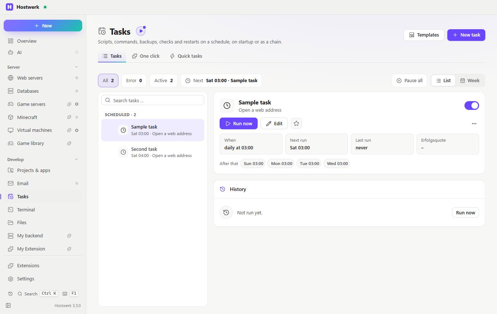
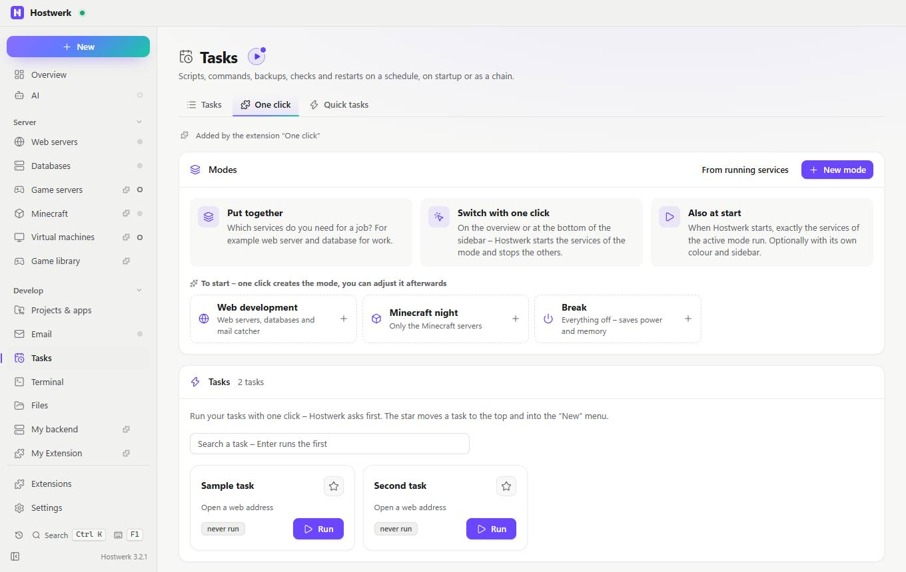
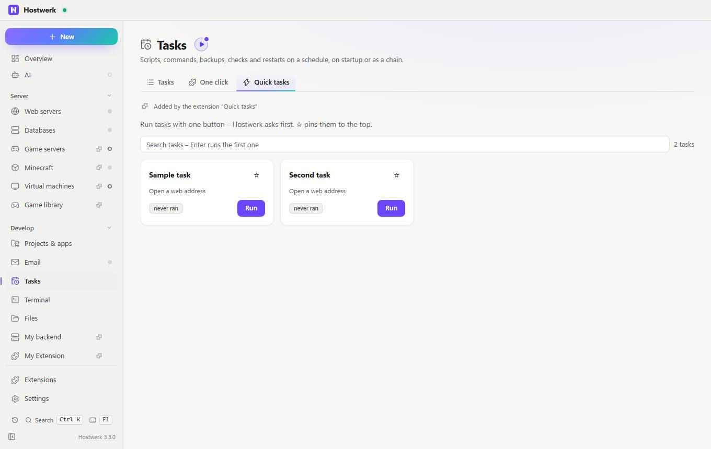

# Tasks

[← Back to the overview](README.md)

Scripts, commands, backups, checks and restarts on a schedule, on startup or as a chain.

### Areas on this page

- History

### What you can do here

- 2 videos
- Templates
- New task
- All 2
- Error 0
- Active 2
- Pause all
- Sample task Sat 03:00 · Open a web address
- Second task Sat 04:00 · Open a web address
- Run now
- Edit
- Mark as favorite (then listed at the top)
- More actions for Sample task

## Tabs

### One click

**Areas on this page:** Modes · Tasks

**What you can do here:** 2 videos · From the extension “One click” – info · From running services · New mode · Web development Web servers, databases and mail catcher · Minecraft night Only the Minecraft servers · Break Everything off – saves power and memory · Mark as favorite (then listed at the top) · Run

### Quick tasks

**What you can do here:** 2 videos · From the extension “Quick tasks” – info

Generated on 2026-11-20 · Hostwerk 3.2.2
