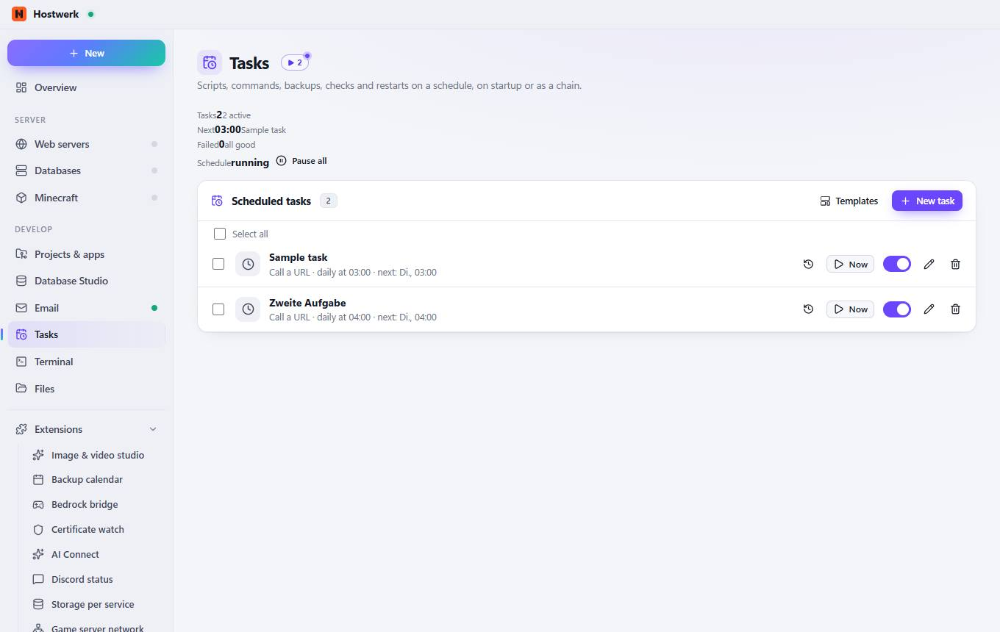

# Tasks

[← Back to the overview](README.md)

Scripts, commands, backups, checks and restarts on a schedule, on startup or as a chain.

### Areas on this page

- Scheduled tasks

### What you can do here

- Pause all
- Templates
- New task
- History
- Now
- Edit
- Delete

Generated on 2026-10-19 · Hostwerk 2.9.0
