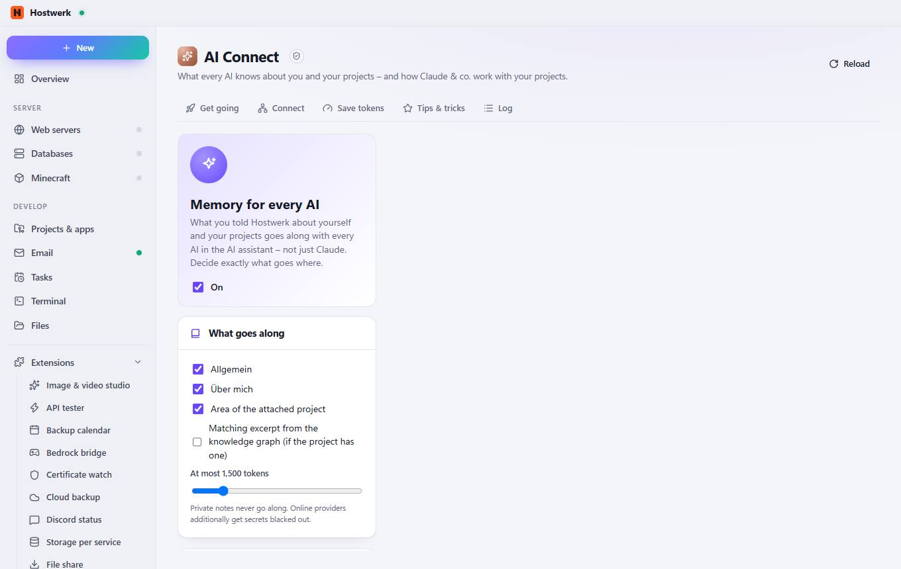
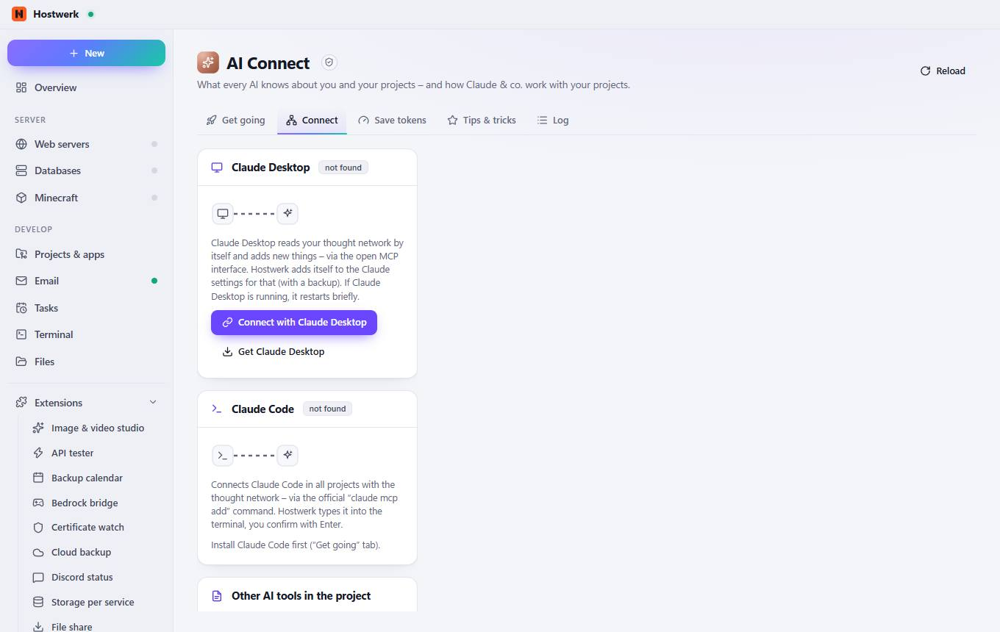
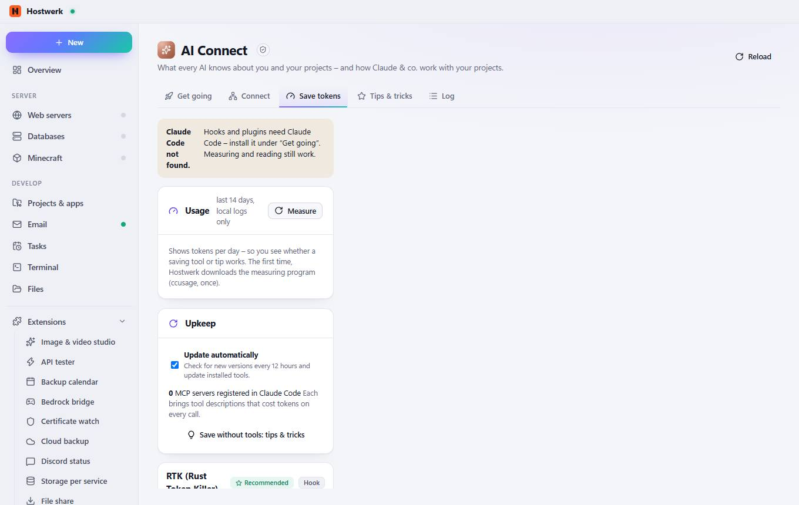
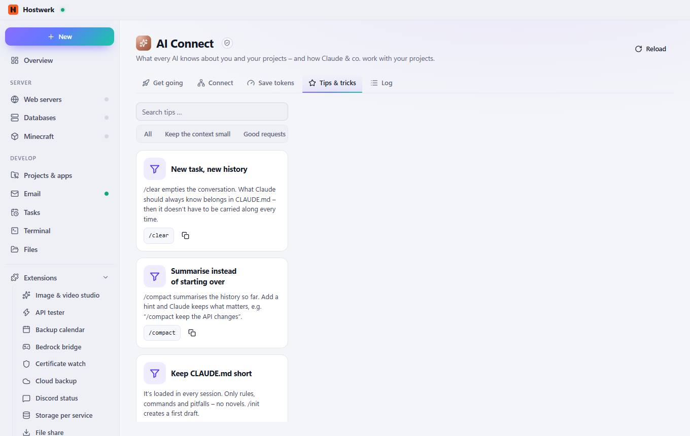
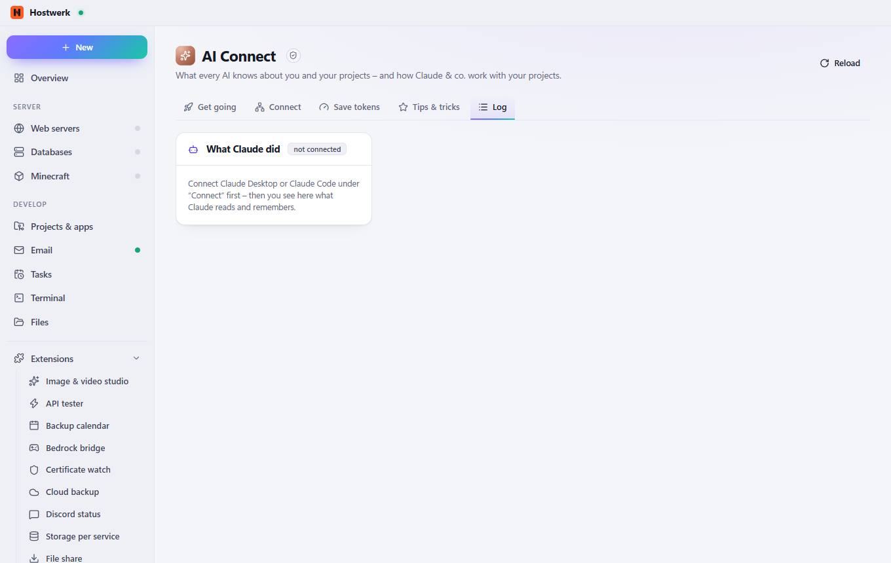

# AI Connect

[← Back to the overview](README.md)

What every AI knows about you and your projects – and how Claude & co. work with your projects.

### Good to know

- Sandboxed extension by Hostwerk · v1.2.0 · may change things after asking Read Claude status, projects, memory context, token-saving tools and usage Set up Claude: context in project files, token-saving tools (asks first) Type commands into the terminal (you confirm) Read the knowledge graph (projects, graph, report, memory, Claude status) Connect Claude and forget it again (asks first) Store own data (max. 256 KB)

### What you can do here

- Reload

## Tabs

### Connect

> Sandboxed extension by Hostwerk · v1.2.0 · may change things after asking Read Claude status, projects, memory context, token-saving tools and usage Set up Claude: context in project files, token-saving tools (asks first) Type commands into the terminal (you confirm) Read the knowledge graph (projects, graph, report, memory, Claude status) Connect Claude and forget it again (asks first) Store own data (max. 256 KB)

**What you can do here:** Reload

### Save tokens

> Sandboxed extension by Hostwerk · v1.2.0 · may change things after asking Read Claude status, projects, memory context, token-saving tools and usage Set up Claude: context in project files, token-saving tools (asks first) Type commands into the terminal (you confirm) Read the knowledge graph (projects, graph, report, memory, Claude status) Connect Claude and forget it again (asks first) Store own data (max. 256 KB)

**What you can do here:** Reload

### Tips & tricks

> Sandboxed extension by Hostwerk · v1.2.0 · may change things after asking Read Claude status, projects, memory context, token-saving tools and usage Set up Claude: context in project files, token-saving tools (asks first) Type commands into the terminal (you confirm) Read the knowledge graph (projects, graph, report, memory, Claude status) Connect Claude and forget it again (asks first) Store own data (max. 256 KB)

**What you can do here:** Reload

### Log

> Sandboxed extension by Hostwerk · v1.2.0 · may change things after asking Read Claude status, projects, memory context, token-saving tools and usage Set up Claude: context in project files, token-saving tools (asks first) Type commands into the terminal (you confirm) Read the knowledge graph (projects, graph, report, memory, Claude status) Connect Claude and forget it again (asks first) Store own data (max. 256 KB)

**What you can do here:** Reload

Generated on 2026-10-20 · Hostwerk 2.10.0
