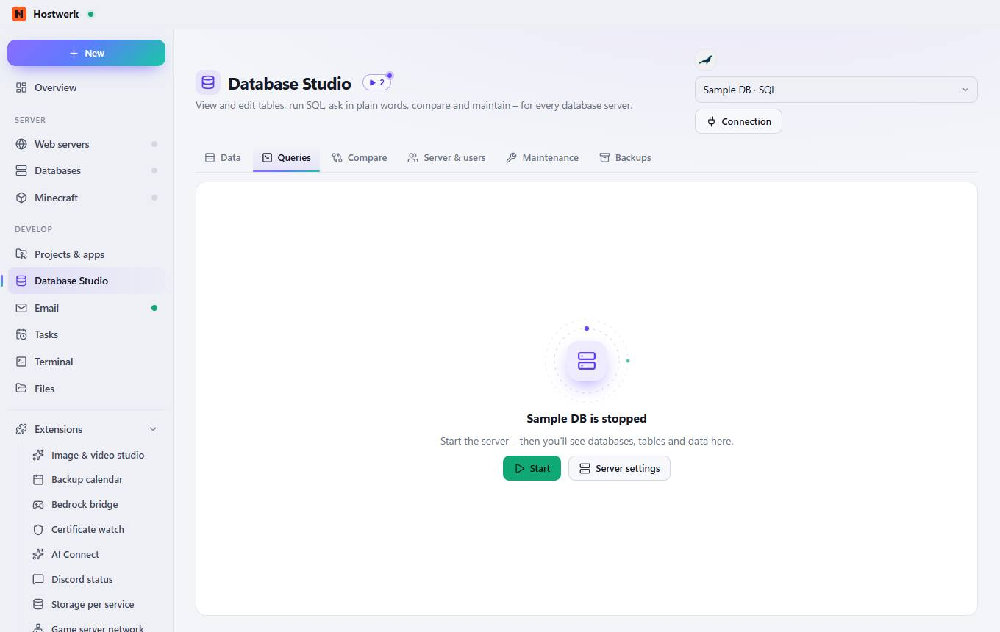
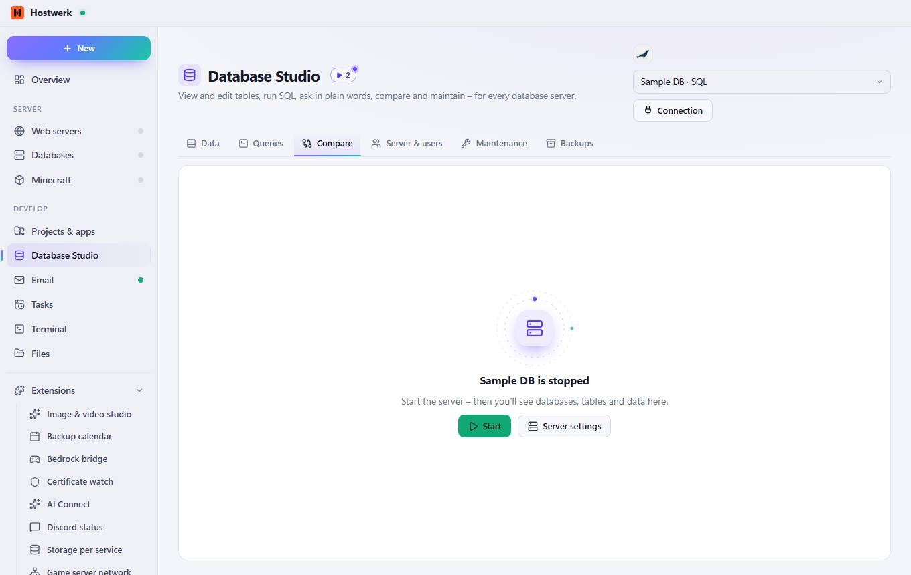
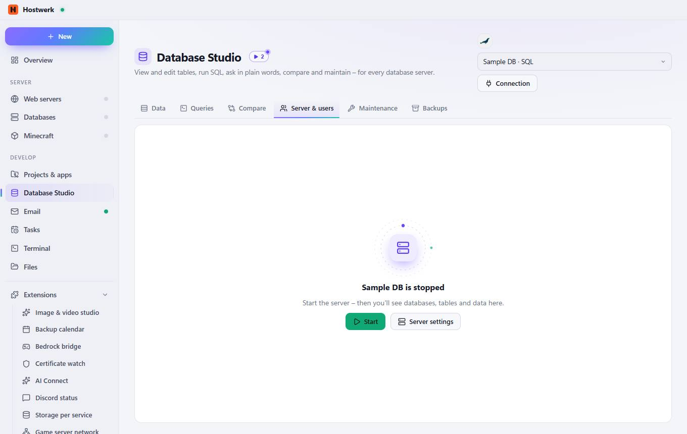
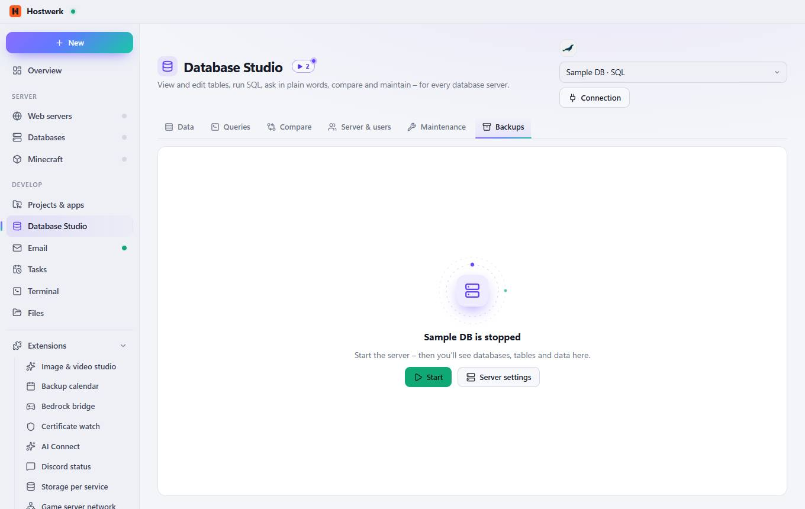

# Database Studio

[← Back to the overview](README.md)

View and edit tables, run SQL, ask in plain words, compare and maintain – for every database server.

### What you can do here

- Connection
- Start
- Server settings

## Tabs

### Queries

**What you can do here:** Connection · Start · Server settings

### Compare

**What you can do here:** Connection · Start · Server settings

### Server & users

**What you can do here:** Connection · Start · Server settings

### Maintenance

**What you can do here:** Connection · Start · Server settings

### Backups

**What you can do here:** Connection · Start · Server settings

Generated on 2026-10-19 · Hostwerk 2.9.0
