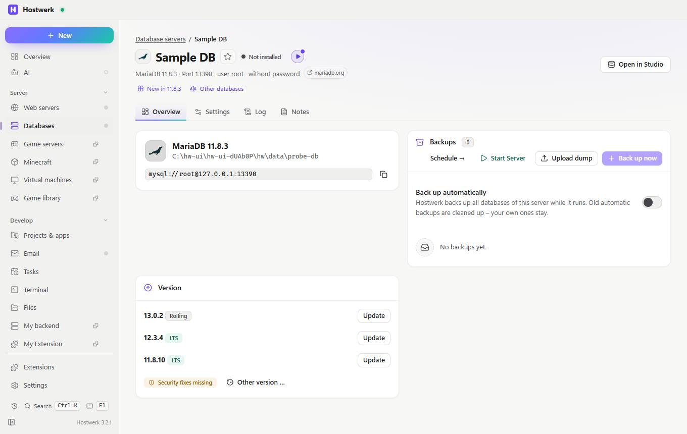
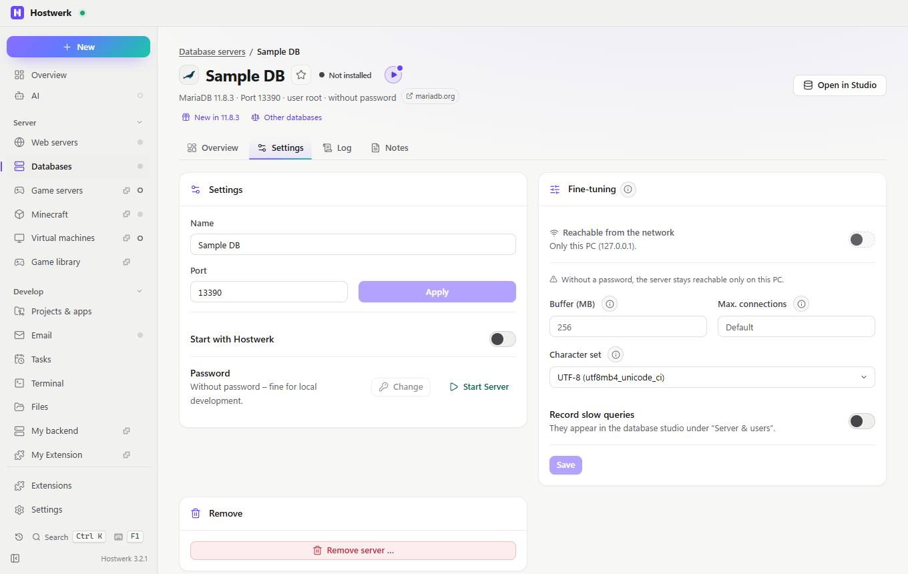
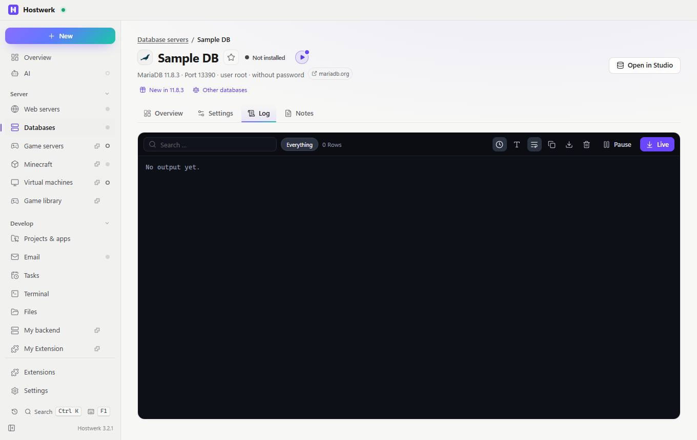
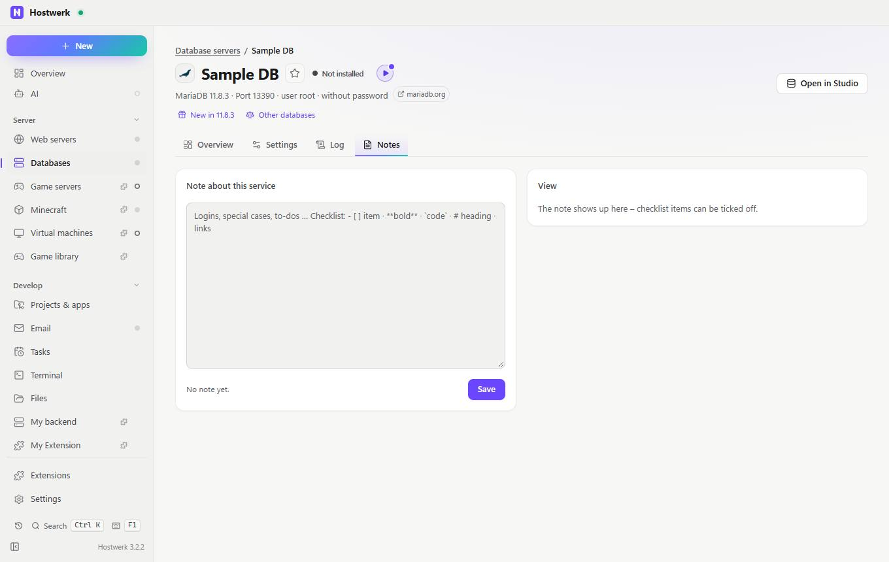

# Sample DB → Overview

[← Back to the overview](README.md)

MariaDB 11.8.3 · Port 13390 · user root · without password mariadb.org

### Areas on this page

- Backups
- Version

### What you can do here

- Change image
- Mark as favorite (then listed at the top)
- 2 videos
- mariadb.org
- New in 11.8.3
- Other databases
- Open in Studio
- Copy
- Schedule →
- Start Server
- Upload dump
- Back up now
- Update
- Other version …

### Inputs

- Back up automatically

## Tabs

### Settings

> Hostwerk writes the server configuration from this. Changes take effect after a restart – if the server is running, Hostwerk restarts it when saving.
> innodb_buffer_pool_size: memory for tables and indexes. The larger, the less often the disk is needed. Hostwerk default: 256 MB.
> How many programs may be connected at the same time. Empty = database default (usually 100 or 151).
> Applies to new databases and tables without their own setting. utf8mb4 supports all characters including emojis.

**Areas on this page:** Settings · Fine-tuning · Remove

**What you can do here:** Change image · Mark as favorite (then listed at the top) · 2 videos · mariadb.org · New in 11.8.3 · Other databases · Open in Studio · Apply · Change · Start Server · Save · Remove server …

### Log

**What you can do here:** Change image · Mark as favorite (then listed at the top) · 2 videos · mariadb.org · New in 11.8.3 · Other databases · Open in Studio · Everything · Show time · Larger font · Wrap long lines · Copy · Save as text file · Empty · Pause · Live

### Notes

**What you can do here:** Change image · Mark as favorite (then listed at the top) · 2 videos · mariadb.org · New in 11.8.3 · Other databases · Open in Studio

Generated on 2026-11-18 · Hostwerk 3.2.1
