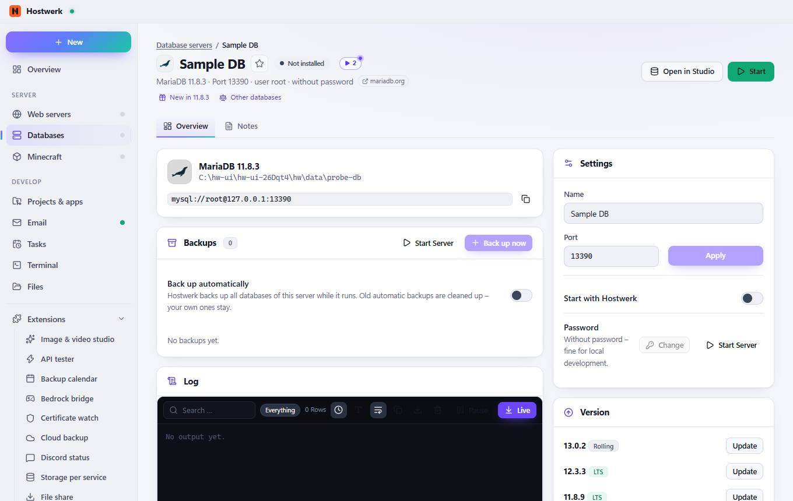
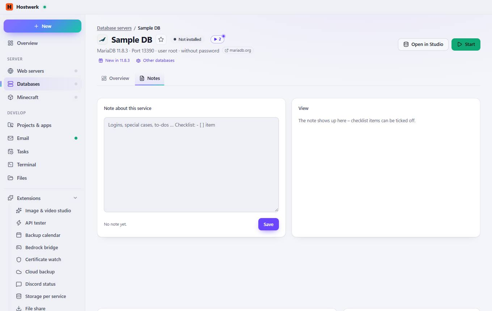

# Sample DB → Overview

[← Back to the overview](README.md)

MariaDB 11.8.3 · Port 13390 · user root · without password mariadb.org

### Areas on this page

- Backups
- Log
- Settings
- Version
- Remove

### What you can do here

- Change image
- Mark as favorite (then listed at the top)
- mariadb.org
- New in 11.8.3
- Other databases
- Open in Studio
- Start
- Copy
- Start Server
- Back up now
- Everything
- Show time
- Larger font
- Wrap long lines
- Save as text file
- Empty
- Pause
- Live
- Apply
- Change
- Update
- Remove server …

### Inputs

- Back up automatically
- Name
- Port
- Start with Hostwerk
- Password

## Tabs

### Notes

**Areas on this page:** Backups · Log · Settings · Version · Remove

**What you can do here:** Change image · Mark as favorite (then listed at the top) · mariadb.org · New in 11.8.3 · Other databases · Open in Studio · Start · Copy · Start Server · Back up now · Everything · Show time · Larger font · Wrap long lines · Save as text file · Empty · Pause · Live · Apply · Change · Update · Remove server …

Generated on 2026-10-20 · Hostwerk 2.10.0
