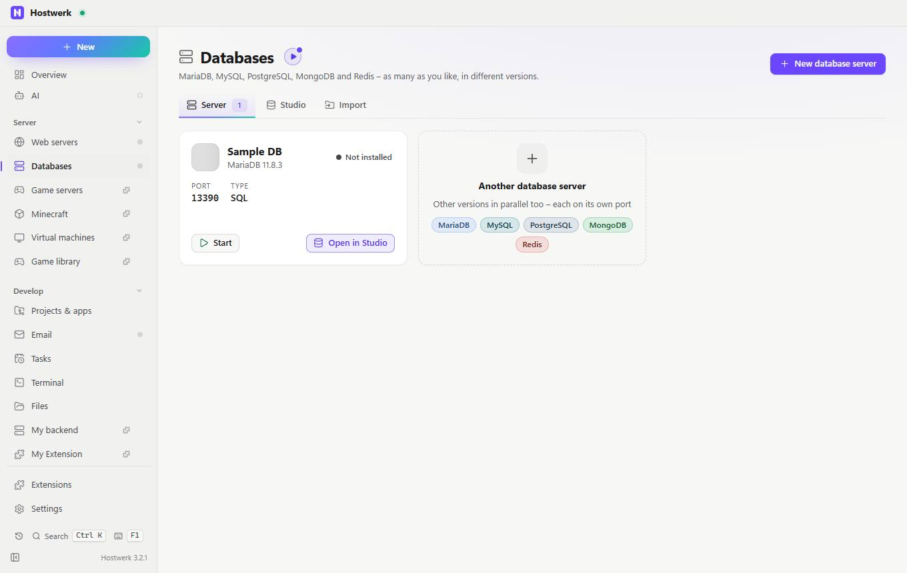
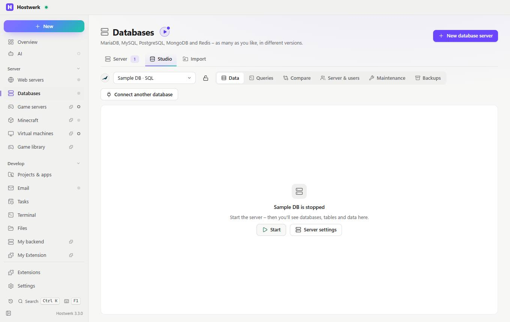
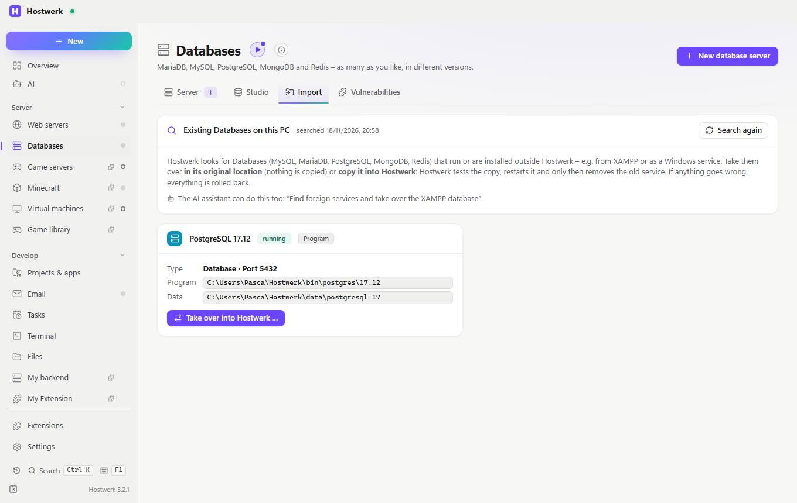

# Databases

[← Back to the overview](README.md)

MariaDB, MySQL, PostgreSQL, MongoDB and Redis – as many as you like, in different versions.

### What you can do here

- 2 videos
- New database server
- Change image
- Start
- Open in Studio

## Tabs

### Studio

**What you can do here:** 2 videos · New database server · Turn on write protection · Connect another database · Start · Server settings

### Import

> Import – take over existing services Take over existing MySQL, MariaDB, PostgreSQL, MongoDB or Redis servers – where they are or as a copy with all data, tested and with a way back. The same search for all kinds is under System → Foreign services.

**Areas on this page:** Existing Databases on this PC · PostgreSQL 17.12

**What you can do here:** 2 videos · New database server · Search again · Take over into Hostwerk …

Generated on 2026-11-20 · Hostwerk 3.3.0
