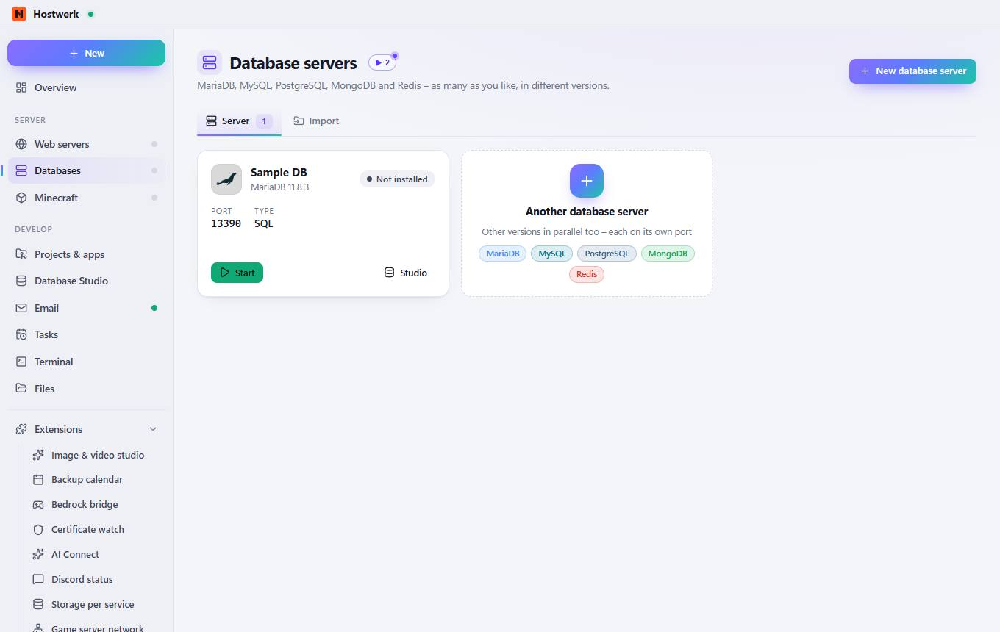
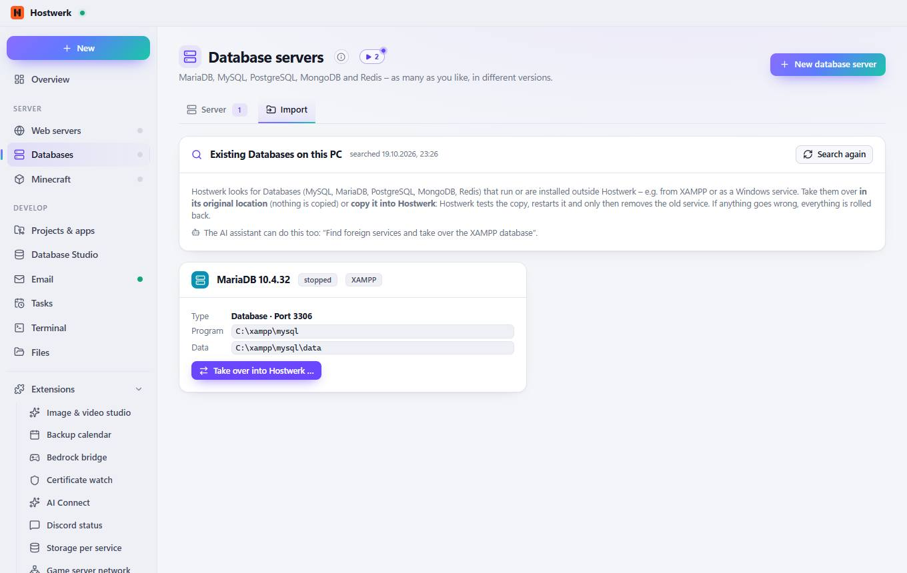

# Database servers

[← Back to the overview](README.md)

MariaDB, MySQL, PostgreSQL, MongoDB and Redis – as many as you like, in different versions.

### What you can do here

- New database server
- Change image
- Start
- Studio

## Tabs

### Import

> Import – take over existing services Take over existing MySQL, MariaDB, PostgreSQL, MongoDB or Redis servers – where they are or as a copy with all data, tested and with a way back. The same search for all kinds is under System → Foreign services.

**Areas on this page:** Existing Databases on this PC · MariaDB 10.4.32

**What you can do here:** New database server · Search again · Take over into Hostwerk …

Generated on 2026-10-19 · Hostwerk 2.9.0
