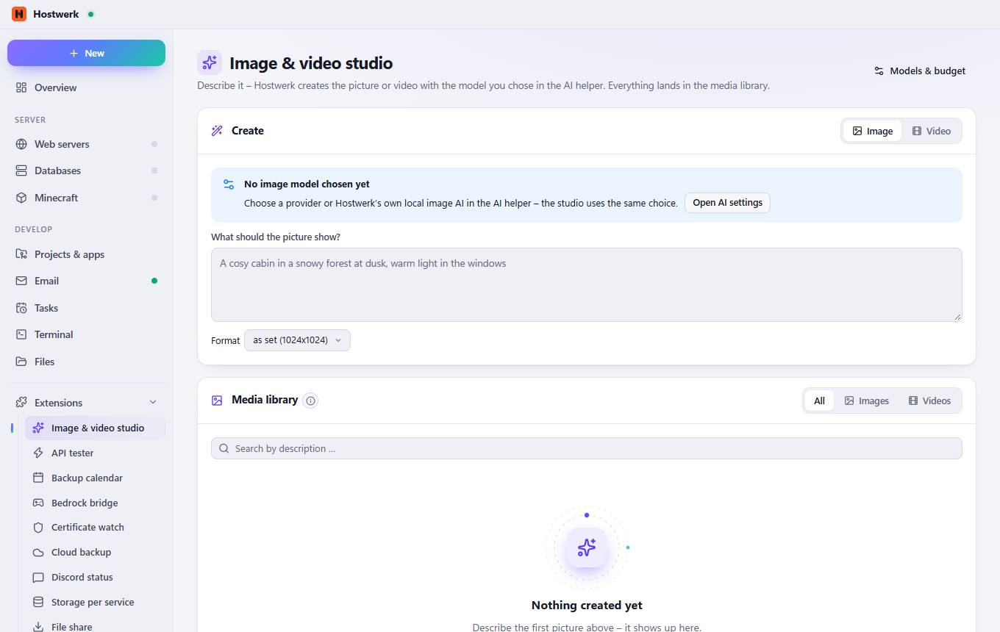

# Image & video studio

[← Back to the overview](README.md)

Describe it – Hostwerk creates the picture or video with the model you chose in the AI helper. Everything lands in the media library.

### Good to know

- Pictures and videos from the studio and from the AI chat. Use one as the start for the next, or name its ID in the chat.

### Areas on this page

- Create
- Media library

### What you can do here

- Models & budget
- Open AI settings

### Inputs

- What should the picture show?

Generated on 2026-10-20 · Hostwerk 2.10.0
