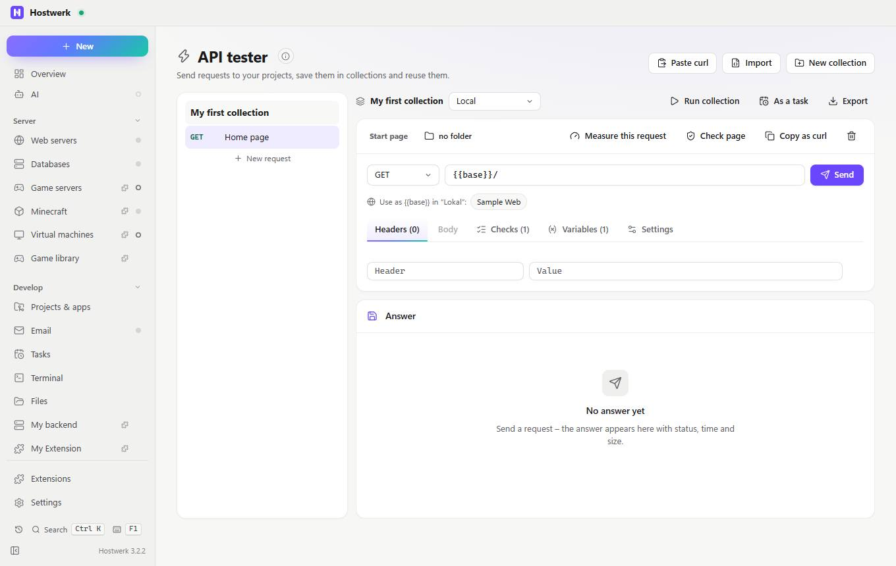
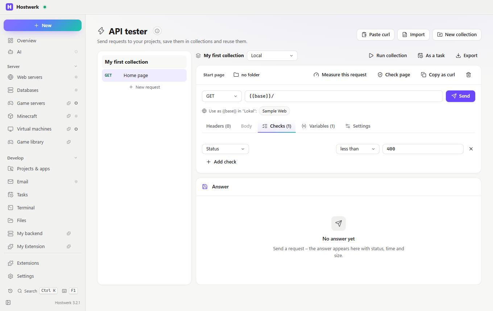
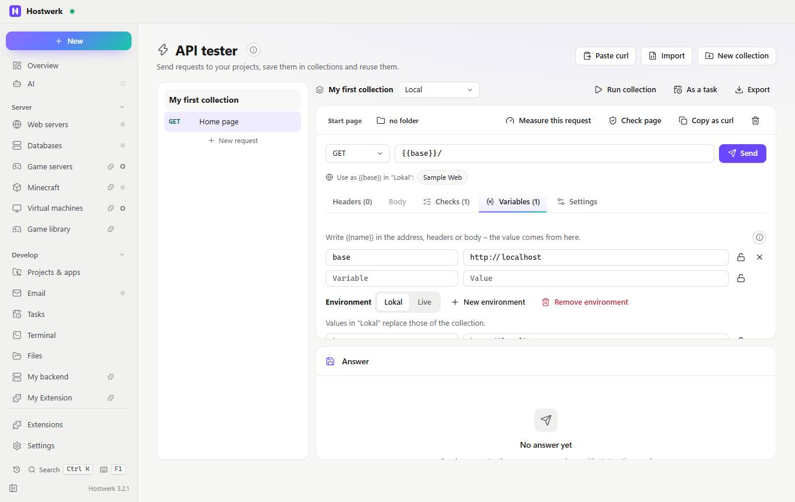
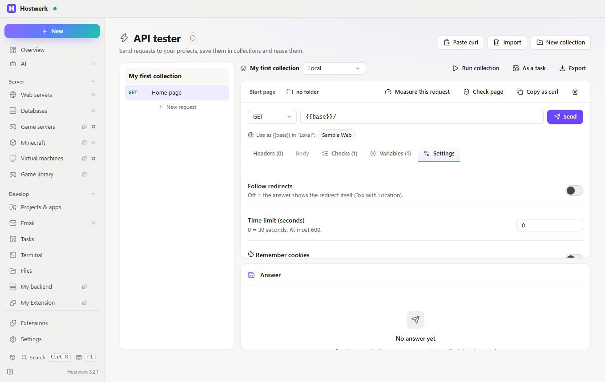

# API tester → Headers (0)

[← Back to the overview](README.md)

Send requests to your projects, save them in collections and reuse them.

### Good to know

- Environments Switch between local, staging and live in one go: the values of the chosen environment replace the variables of the collection – {{base}} points to the right server.

### Areas on this page

- Answer

### What you can do here

- Paste curl
- Import
- New collection
- My first collection
- GET Home page
- New request
- Run collection
- As a task
- Export
- Start page
- no folder
- Measure this request
- Check page
- Copy as curl
- Remove request
- Send
- Sample Web

## Tabs

### Body

> Environments Switch between local, staging and live in one go: the values of the chosen environment replace the variables of the collection – {{base}} points to the right server.

**Areas on this page:** Answer

**What you can do here:** Paste curl · Import · New collection · My first collection · GET Home page · New request · Run collection · As a task · Export · Start page · no folder · Measure this request · Check page · Copy as curl · Remove request · Send · Sample Web

### Checks (1)

> Environments Switch between local, staging and live in one go: the values of the chosen environment replace the variables of the collection – {{base}} points to the right server.

**Areas on this page:** Answer

**What you can do here:** Paste curl · Import · New collection · My first collection · GET Home page · New request · Run collection · As a task · Export · Start page · no folder · Measure this request · Check page · Copy as curl · Remove request · Send · Sample Web · Remove · Add check

### Variables (1)

> Environments Switch between local, staging and live in one go: the values of the chosen environment replace the variables of the collection – {{base}} points to the right server.
> Variables They belong to the collection, so every request in it uses the same values. Secret values (lock) are stored sealed on this PC and only shown masked – the history never keeps them.

**Areas on this page:** Answer

**What you can do here:** Paste curl · Import · New collection · My first collection · GET Home page · New request · Run collection · As a task · Export · Start page · no folder · Measure this request · Check page · Copy as curl · Remove request · Send · Sample Web · Mark as secret · Remove · New environment · Remove environment · Remove collection

### Settings

> Environments Switch between local, staging and live in one go: the values of the chosen environment replace the variables of the collection – {{base}} points to the right server.

**Areas on this page:** Answer

**What you can do here:** Paste curl · Import · New collection · My first collection · GET Home page · New request · Run collection · As a task · Export · Start page · no folder · Measure this request · Check page · Copy as curl · Remove request · Send · Sample Web

Generated on 2026-11-20 · Hostwerk 3.3.0
