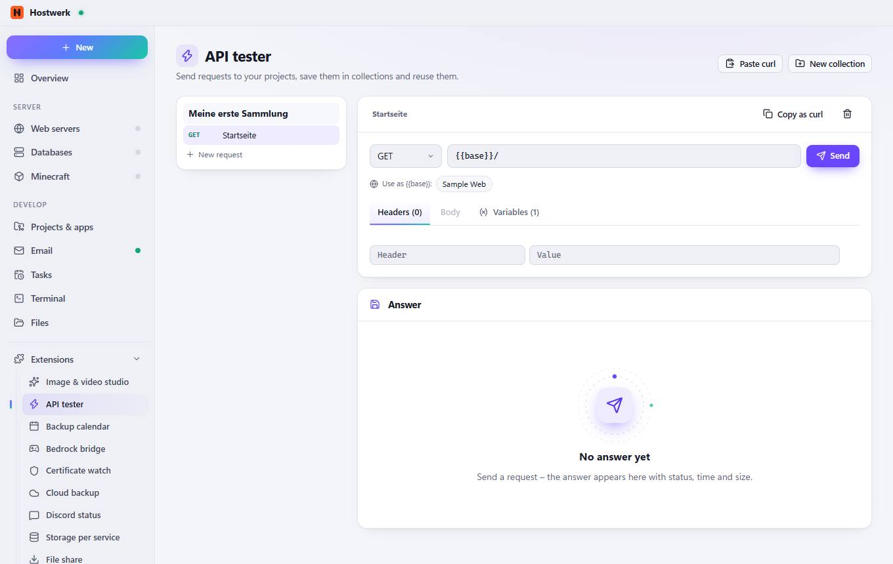
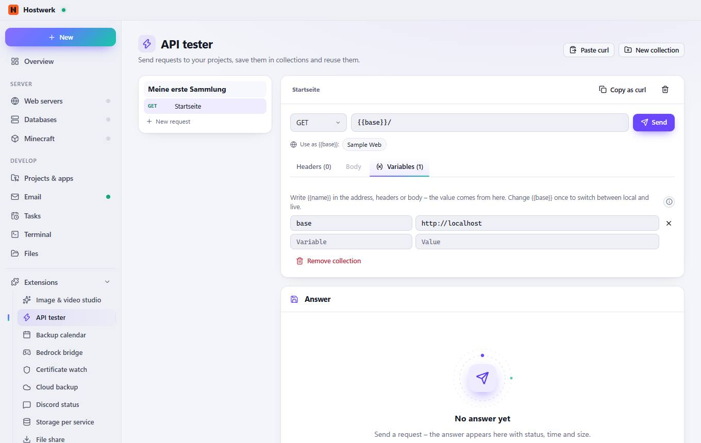

# API tester → Headers (0)

[← Back to the overview](README.md)

Send requests to your projects, save them in collections and reuse them.

### Areas on this page

- Answer

### What you can do here

- Paste curl
- New collection
- Meine erste Sammlung
- GET Startseite
- New request
- Startseite
- Copy as curl
- Remove request
- Send
- Sample Web

## Tabs

### Body

**Areas on this page:** Answer

**What you can do here:** Paste curl · New collection · Meine erste Sammlung · GET Startseite · New request · Startseite · Copy as curl · Remove request · Send · Sample Web

### Variables (1)

> Variables They belong to the collection, so every request in it uses the same values.

**Areas on this page:** Answer

**What you can do here:** Paste curl · New collection · Meine erste Sammlung · GET Startseite · New request · Startseite · Copy as curl · Remove request · Send · Sample Web · Remove · Remove collection

Generated on 2026-10-20 · Hostwerk 2.10.0
