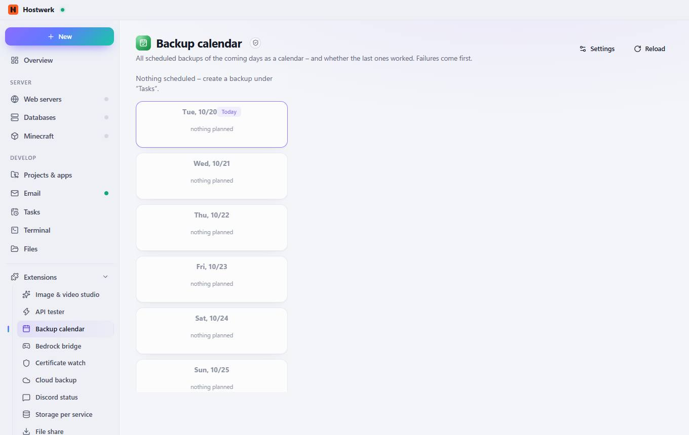

# Backup calendar

[← Back to the overview](README.md)

All scheduled backups of the coming days as a calendar – and whether the last ones worked. Failures come first.

### Good to know

- Sandboxed extension by Hostwerk · v1.2.0 · read only Read scheduled tasks

### What you can do here

- Settings
- Reload

Generated on 2026-10-20 · Hostwerk 2.10.0
