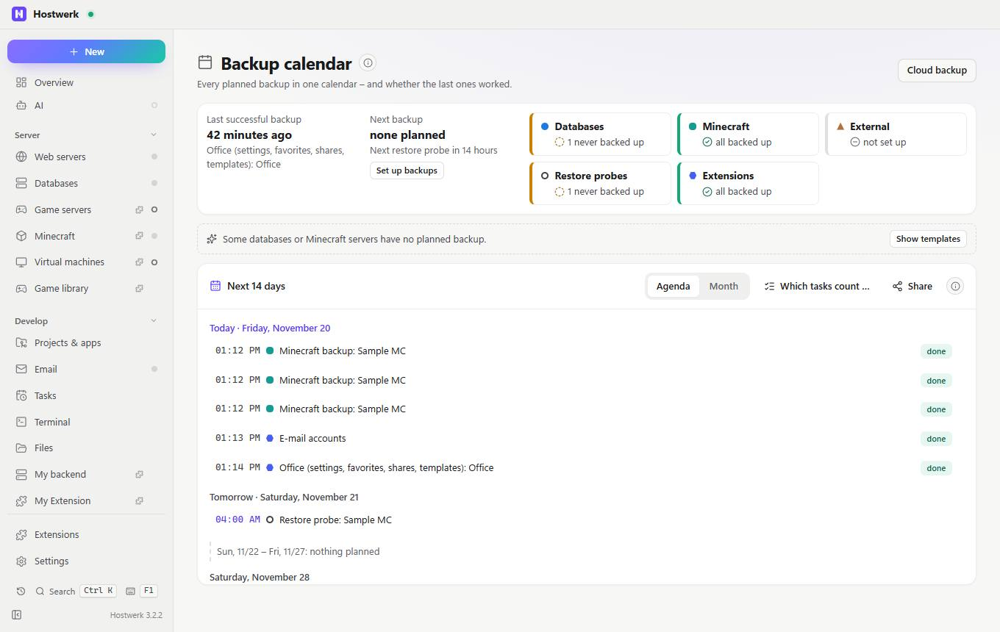

# Backup calendar

[← Back to the overview](README.md)

Every planned backup in one calendar – and whether the last ones worked.

### Good to know

- Backup calendar All scheduled backups – tasks, nightly backups, external backup and restore probes – and whether the last ones worked. Failures come first.
- Share the calendar Export saves the next weeks as a .ics file. The subscription link keeps Outlook, Google, Apple or Thunderbird up to date (“subscribe to calendar” / “add from URL”). It works on this PC – from outside only through Hostwerk’s remote access. Anyone with the link sees the names of your backup tasks.

### Areas on this page

- Status
- Next 14 days

### What you can do here

- Cloud backup
- Set up backups
- Databases 1 never backed up
- Minecraft all backed up
- External not set up
- Restore probes 1 never backed up
- Extensions all backed up
- Show templates
- Which tasks count …
- Share

Generated on 2026-11-20 · Hostwerk 3.3.0
