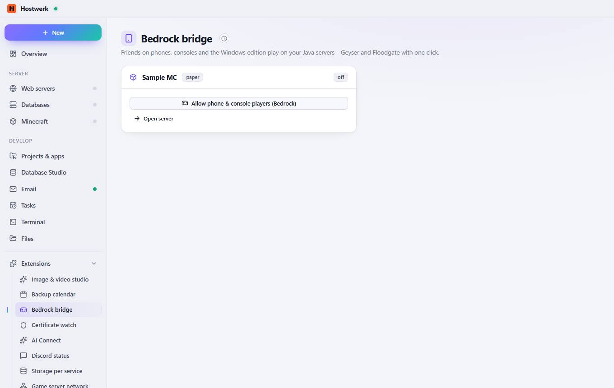

# Bedrock bridge

[← Back to the overview](README.md)

Friends on phones, consoles and the Windows edition play on your Java servers – Geyser and Floodgate with one click.

### Good to know

- How it works Geyser translates between Bedrock and Java, Floodgate lets Bedrock players in without a Java account. Hostwerk picks a free UDP port (19132, 19133 …), sets everything up and keeps both up to date: new builds are downloaded in the background and put in place at the next restart – or right away when nobody is online.

### Areas on this page

- Sample MC

### What you can do here

- Allow phone & console players (Bedrock)
- Open server

Generated on 2026-10-19 · Hostwerk 2.9.0
