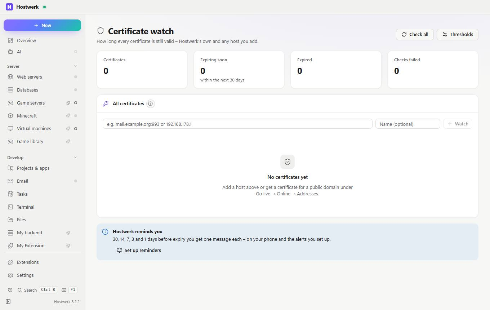

# Certificate watch

[← Back to the overview](README.md)

How long every certificate is still valid – Hostwerk’s own and any host you add.

### Good to know

- Any host and port Hostwerk opens a TLS connection and reads the certificate – web pages (443), mail (465, 993, 995 and 25/587 with STARTTLS), router or NAS. Nothing else is sent.

### Areas on this page

- All certificates

### What you can do here

- Check all
- Thresholds
- Watch
- Set up reminders

Generated on 2026-11-20 · Hostwerk 3.2.2
