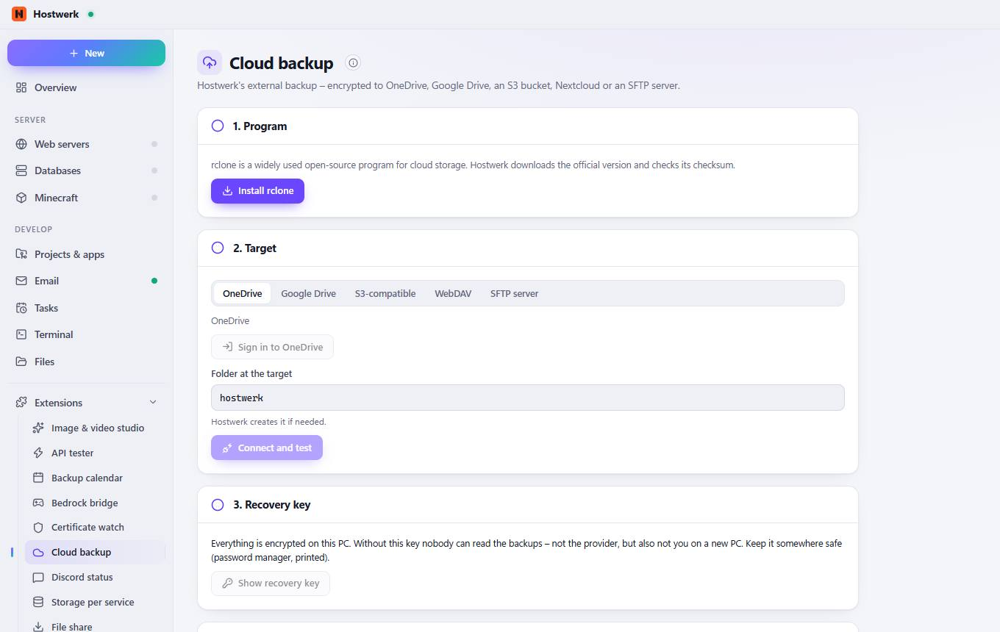

# Cloud backup

[← Back to the overview](README.md)

Hostwerk's external backup – encrypted to OneDrive, Google Drive, an S3 bucket, Nextcloud or an SFTP server.

### Good to know

- How it works Hostwerk keeps doing the backups (databases, Minecraft worlds, web pages) on its schedule. This extension only brings the cloud target: rclone uploads them, encrypted on this PC – the provider never sees the content.

### Areas on this page

- 1. Program
- 2. Target
- 3. Recovery key
- 4. Use for the external backup

### What you can do here

- Install rclone
- Sign in to OneDrive
- Connect and test
- Show recovery key
- Use the cloud for the external backup

### Inputs

- Folder at the target

Generated on 2026-10-20 · Hostwerk 2.10.0
