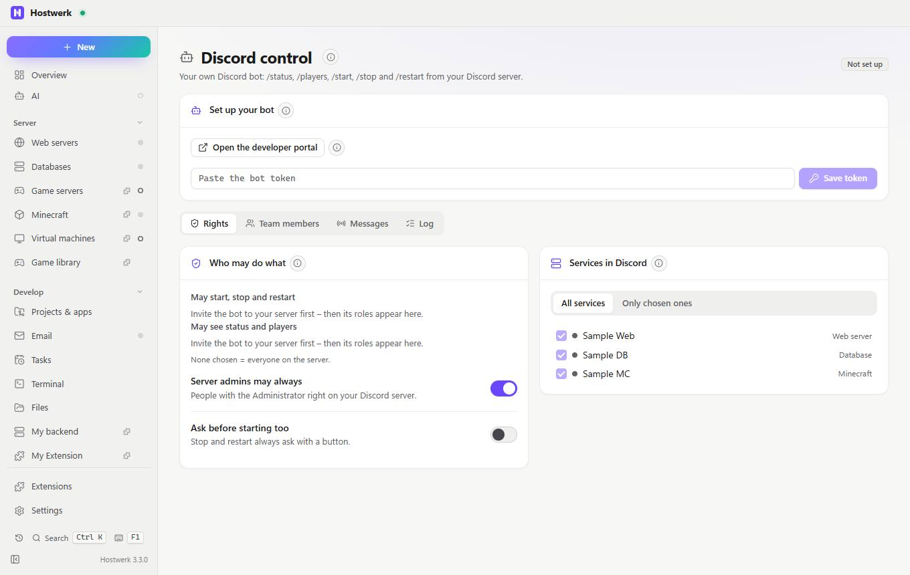

# Discord control

[← Back to the overview](README.md)

Your own Discord bot: /status, /players, /start, /stop and /restart from your Discord server.

### Good to know

- Commands /status – which services run · /players – who is online · /start, /stop, /restart <service> – with a confirm button for stop and restart. German Discord shows /spieler and /neustart.
- Your own bot The bot belongs to you: Hostwerk logs in with your token, the token stays encrypted on this PC and only goes to Discord.
- How to get the token Open the Discord developer portal and create a “New Application” – its name is what people see in Discord, for example “Hostwerk”. Under “Bot” click “Reset Token” and copy the token. No special intents are needed. Paste the token here.
- Rights Everyone on your Discord server may use /status and /players. Starting, stopping and restarting is only for the roles chosen here, server admins (if allowed) and linked team members – for exactly the services shared with them in the Team extension.
- Shared services Only these appear in /status and can be started or stopped from Discord. Others stay invisible there – even for admins.

### Areas on this page

- Set up your bot
- Who may do what
- Services in Discord

### What you can do here

- Open the developer portal
- Save token

### Inputs

- May start, stop and restart
- May see status and players
- Server admins may always
- Ask before starting too

Generated on 2026-11-20 · Hostwerk 3.3.0
