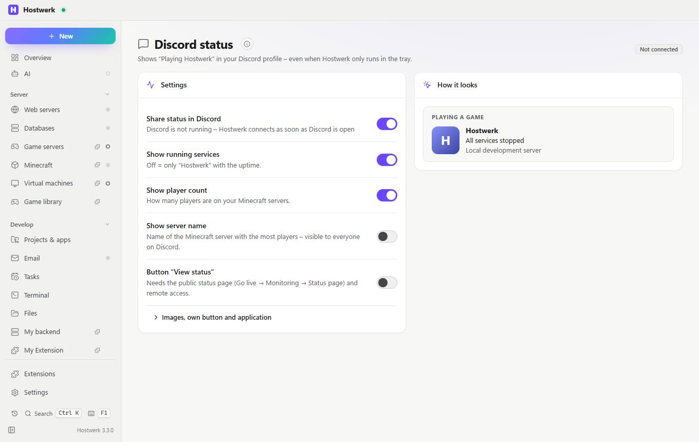

# Discord status

[← Back to the overview](README.md)

Shows “Playing Hostwerk” in your Discord profile – even when Hostwerk only runs in the tray.

### Good to know

- What is shared? Only kinds of services (for example web server · database) and how many are running. Never project or folder names – a server name only if you switch it on.

### Areas on this page

- Settings
- How it looks

### What you can do here

- Images, own button and application

### Inputs

- Share status in Discord
- Show running services
- Show player count
- Show server name
- Button “View status”

Generated on 2026-11-20 · Hostwerk 3.3.0
