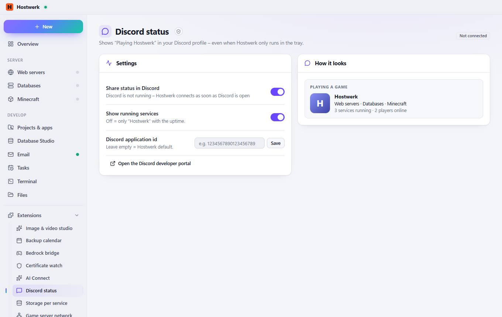

# Discord status

[← Back to the overview](README.md)

Shows “Playing Hostwerk” in your Discord profile – even when Hostwerk only runs in the tray.

### Good to know

- What is shared? Only kinds of services (for example web server · database) and how many are running. Never project, server or folder names.

### Areas on this page

- Settings
- How it looks

### What you can do here

- Save
- Open the Discord developer portal

### Inputs

- Share status in Discord
- Show running services
- Discord application id

Generated on 2026-10-19 · Hostwerk 2.9.0
