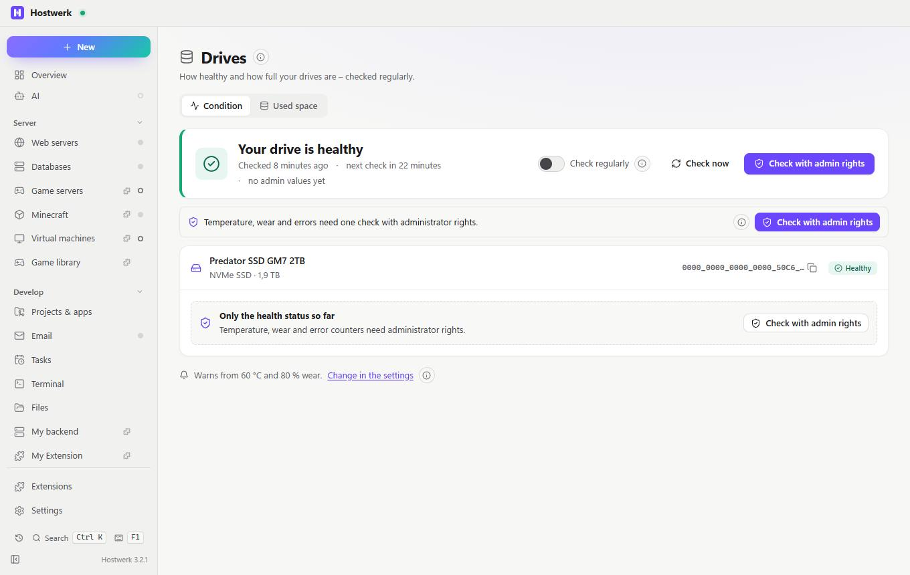

# Drives

[← Back to the overview](README.md)

How healthy and how full your drives are – checked regularly.

### Good to know

- Drives Hostwerk reads the S.M.A.R.T. values of every drive – temperature, wear, errors – and tells you when something gets worse, and shows how full the drive is and who uses the space. Nothing on a drive is ever changed.
- Check regularly with admin rights Hostwerk sets up a Windows task that reads the values every hour with administrator rights. Windows asks for permission once. The task only reads and removes itself when you uninstall the extension.
- Why administrator rights? Without administrator rights Windows only shows whether a drive is healthy. Temperature, wear and error counters are read in a single check – Windows asks for permission once. Hostwerk itself keeps running without admin rights.
- Notifications Warnings go to Hostwerk’s notifications (push, Discord, ntfy, mail) and appear under Go live → Monitoring → Watchers.

### Areas on this page

- Predator SSD GM7 2TB

### What you can do here

- Check now
- Check with admin rights
- 0000_0000_0000_0000_50C6_8E52_7150_2160

Generated on 2026-11-18 · Hostwerk 3.2.1
