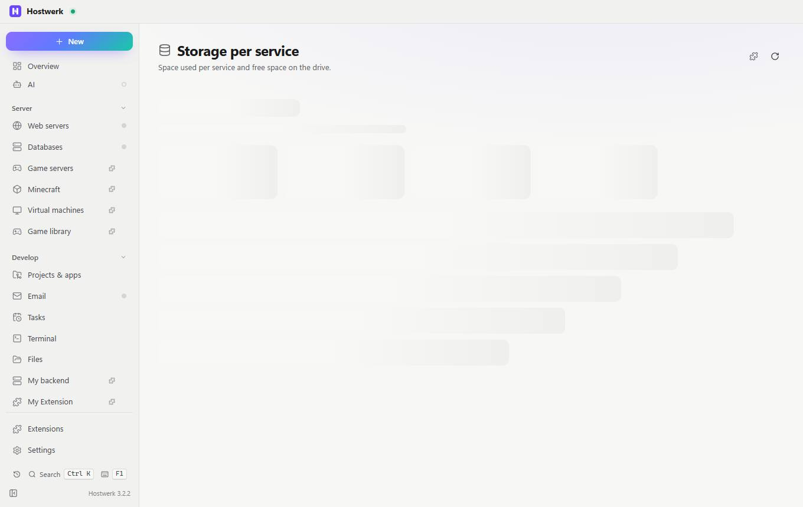

# Storage per service

[← Back to the overview](README.md)

Space used per service and free space on the drive.

### What you can do here

- From the extension “Storage per service” – info
- Reload

Generated on 2026-11-20 · Hostwerk 3.3.0
