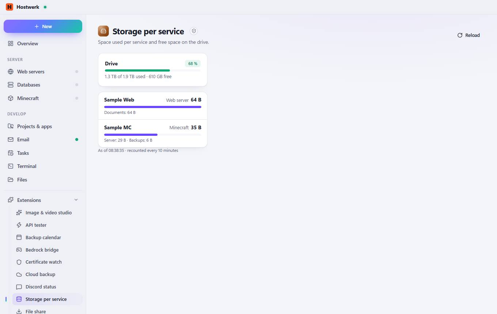

# Storage per service

[← Back to the overview](README.md)

Space used per service and free space on the drive.

### Good to know

- Sandboxed extension by Hostwerk · v1.1.0 · read only Read system health, load and ports

### What you can do here

- Reload

Generated on 2026-10-20 · Hostwerk 2.10.0
