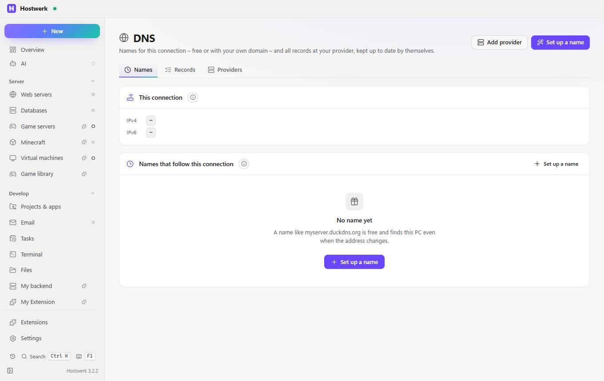
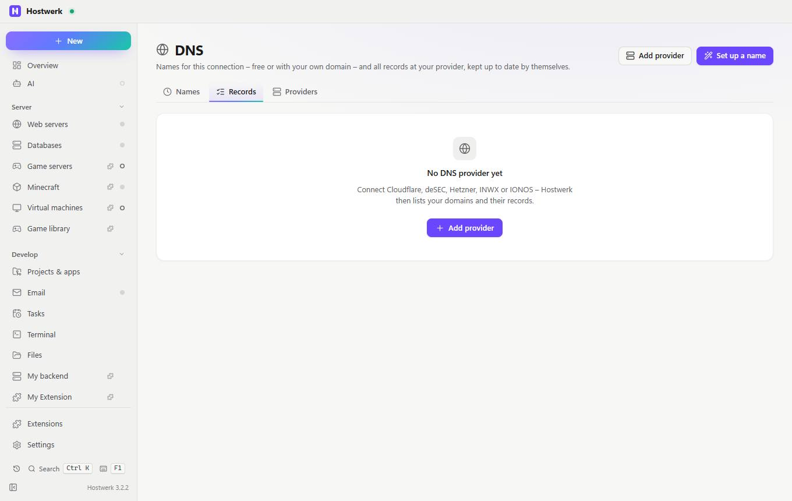
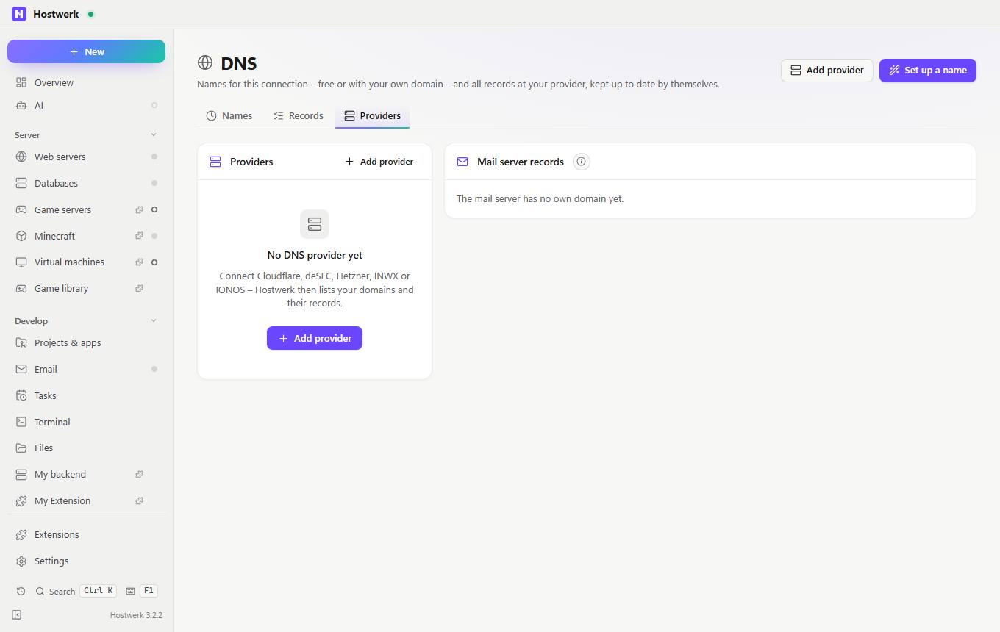

# DNS → Names

[← Back to the overview](README.md)

Names for this connection – free or with your own domain – and all records at your provider, kept up to date by themselves.

### Good to know

- This connection The address the internet sees. Hostwerk asks several services (no account needed) and only trusts an address two of them agree on. For IPv6 it uses this PC’s fixed address, not the changing privacy address.
- Maintenance-free Every 5 minutes Hostwerk checks the address and updates a name only when it changed. Every 6 hours it checks that the world really sees this connection. Problems come as one notification; a provider that is down is retried with growing pauses.

### Areas on this page

- This connection
- Names that follow this connection

### What you can do here

- Add provider
- Set up a name

## Tabs

### Records

**What you can do here:** Add provider · Set up a name

### Providers

> Mail server records MX, SPF, DKIM and DMARC from the extension “Mail server”. Records that are missing at your provider are set with one click; existing SPF/DMARC records are replaced, nothing else is touched.

**Areas on this page:** Providers · Mail server records

**What you can do here:** Add provider · Set up a name

Generated on 2026-11-20 · Hostwerk 3.2.2
