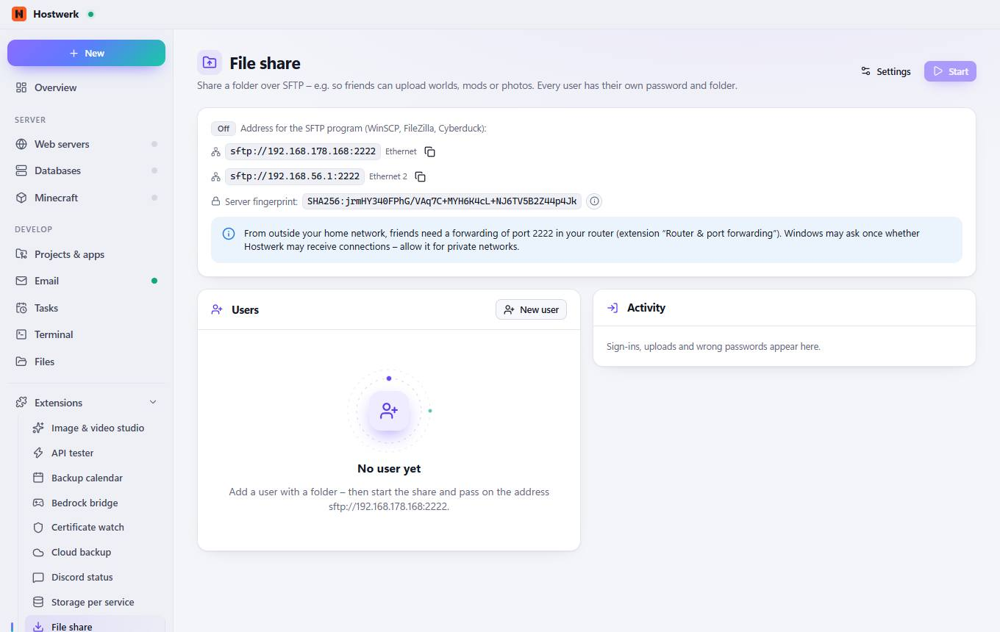

# File share

[← Back to the overview](README.md)

Share a folder over SFTP – e.g. so friends can upload worlds, mods or photos. Every user has their own password and folder.

### Good to know

- Fingerprint On the first connection the SFTP program shows this fingerprint. If it is the same, the connection really goes to this PC.

### Areas on this page

- Users
- Activity

### What you can do here

- Settings
- Start
- Copy
- New user

Generated on 2026-10-20 · Hostwerk 2.10.0
