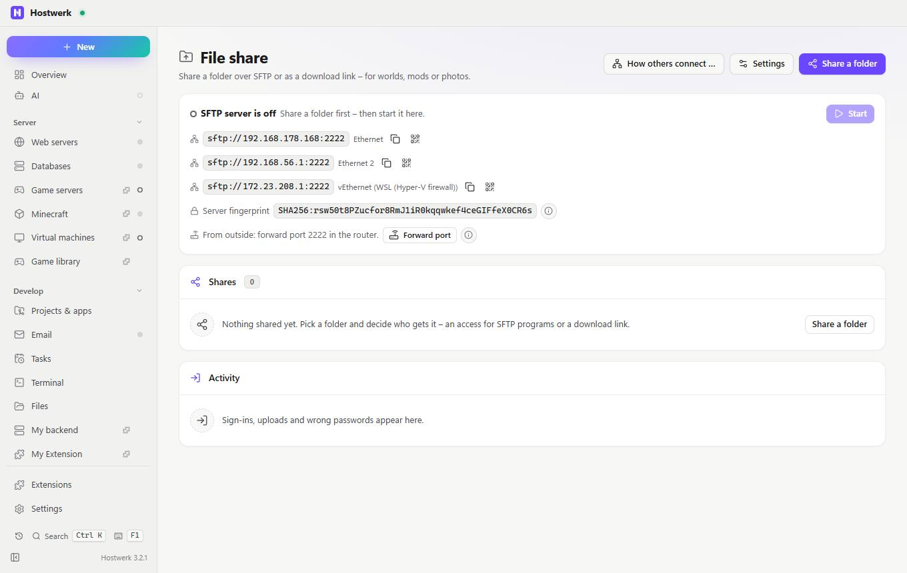

# File share

[← Back to the overview](README.md)

Share a folder over SFTP or as a download link – for worlds, mods or photos.

### Good to know

- Fingerprint On the first connection the SFTP program shows this fingerprint. If it is the same, the connection really goes to this PC.
- Router Windows may ask once whether Hostwerk may receive connections – allow it for private networks.

### Areas on this page

- Shares
- Activity

### What you can do here

- How others connect …
- Settings
- Share a folder
- Start
- Copy
- Show as QR code
- Forward port

Generated on 2026-11-18 · Hostwerk 3.2.1
