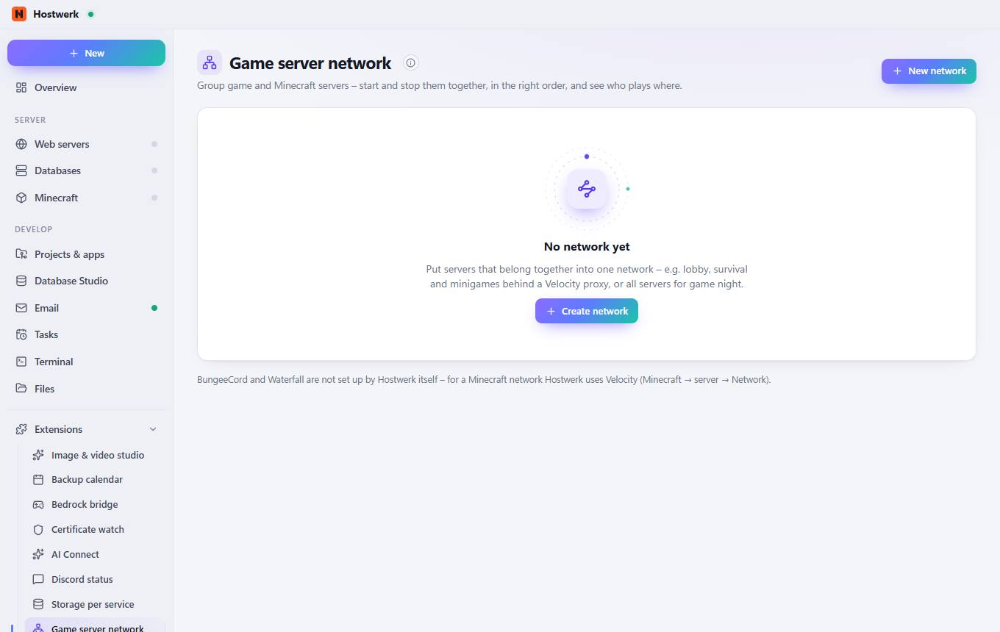

# Game server network

[← Back to the overview](README.md)

Group game and Minecraft servers – start and stop them together, in the right order, and see who plays where.

### Good to know

- How the order works Starting brings up every backend first and the proxy (Velocity) last, with the pause you chose in between. Stopping goes the other way round: the proxy first, so nobody lands on a server that is going down.

### What you can do here

- New network
- Create network

Generated on 2026-10-19 · Hostwerk 2.9.0
