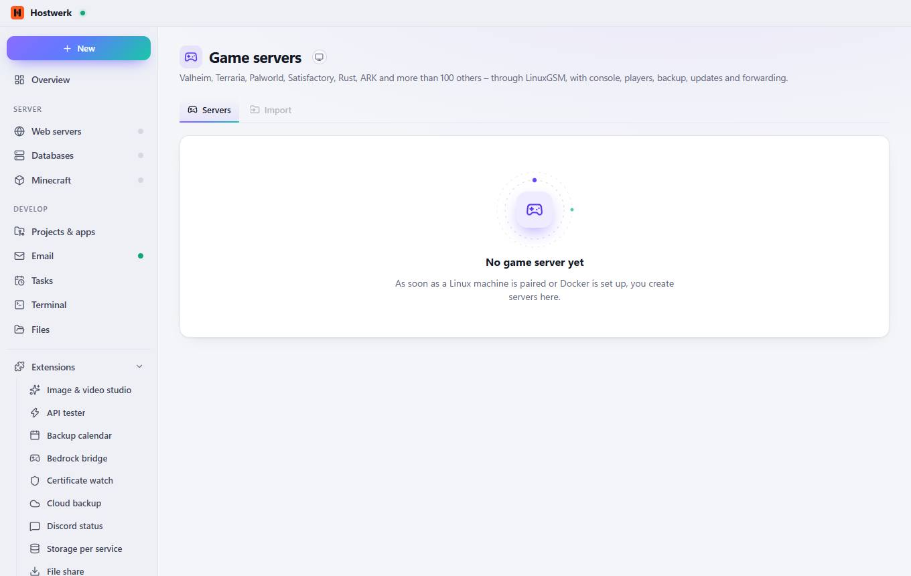

# Game servers → Servers

[← Back to the overview](README.md)

Valheim, Terraria, Palworld, Satisfactory, Rust, ARK and more than 100 others – through LinuxGSM, with console, players, backup, updates and forwarding.

### Good to know

- Only on Linux – or with Docker LinuxGSM (linuxgsm.com) only runs on Linux. Three ways: Own server (VPS) – set it up with the Hostwerk network extension; this page is then ready there (switch the machine at the top). Linux PC at home – install Hostwerk for Linux and pair it. Docker here – set up the Hostwerk Docker engine under Projects & apps → Docker; then game servers run as containers on this PC. Minecraft servers keep running right here on Windows.

## Tabs

### Import

> Only on Linux – or with Docker LinuxGSM (linuxgsm.com) only runs on Linux. Three ways: Own server (VPS) – set it up with the Hostwerk network extension; this page is then ready there (switch the machine at the top). Linux PC at home – install Hostwerk for Linux and pair it. Docker here – set up the Hostwerk Docker engine under Projects & apps → Docker; then game servers run as containers on this PC. Minecraft servers keep running right here on Windows.

Generated on 2026-10-20 · Hostwerk 2.10.0
