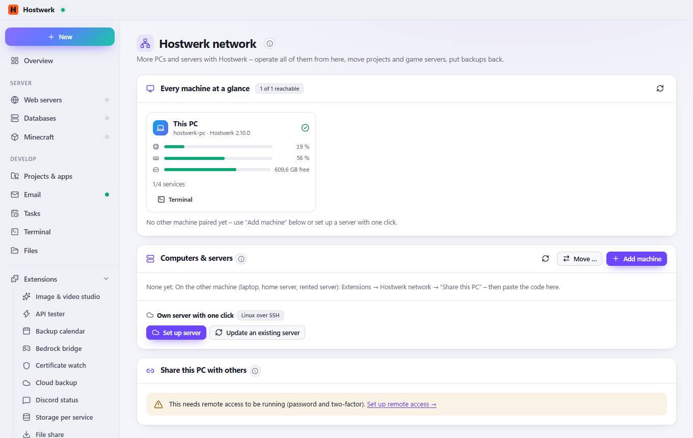

# Hostwerk network

[← Back to the overview](README.md)

More PCs and servers with Hostwerk – operate all of them from here, move projects and game servers, put backups back.

### Good to know

- How it works Install Hostwerk on the other machine (Windows or Linux; a rented server works with “Own server with one click”), switch on remote access there and enter the pairing code here. Then switch between the devices in the machine bar at the top – services, files, terminal and AI then run on the chosen machine. Linux servers in a data centre · Windows or Linux PCs at home · Phone: under Go live → Remote access
- Rented server (e.g. at Hetzner, Netcup, IONOS) or a home server with Ubuntu, Debian or Fedora: Hostwerk sets itself up there – Node.js, Hostwerk without a window as a service, remote access with two-factor, firewall – and then shows up here as a machine. Your SSH sign-in is only used for the setup and never stored.
- Another Hostwerk PC can then operate this machine – through remote access (HTTPS) with its own key that you can revoke at any time. The key is shown only once.

### Areas on this page

- Every machine at a glance
- Computers & servers
- Share this PC with others

### What you can do here

- Reload
- Terminal
- Check again
- Move …
- Add machine
- Set up server
- Update an existing server

Generated on 2026-10-20 · Hostwerk 2.10.0
