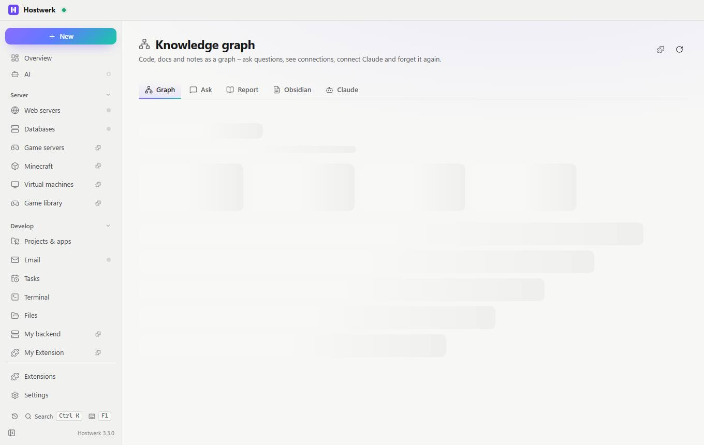
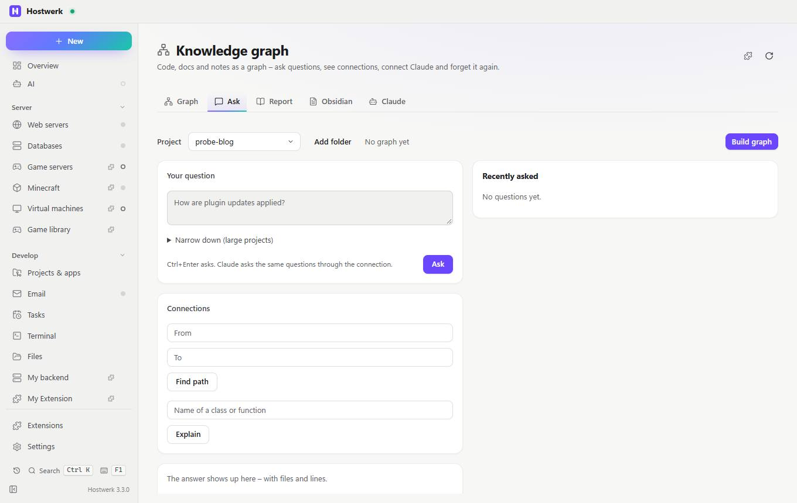
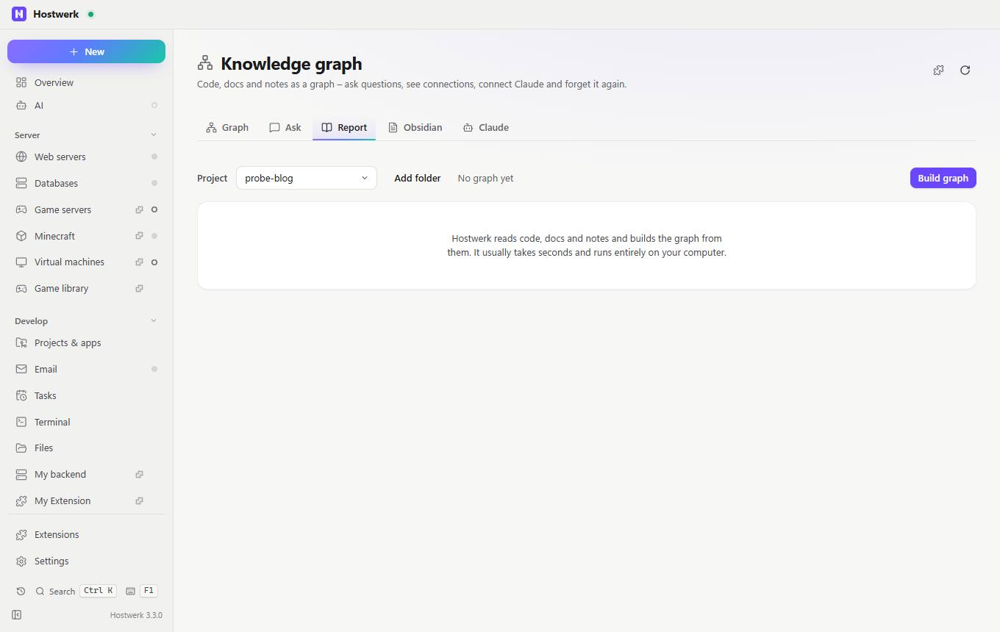
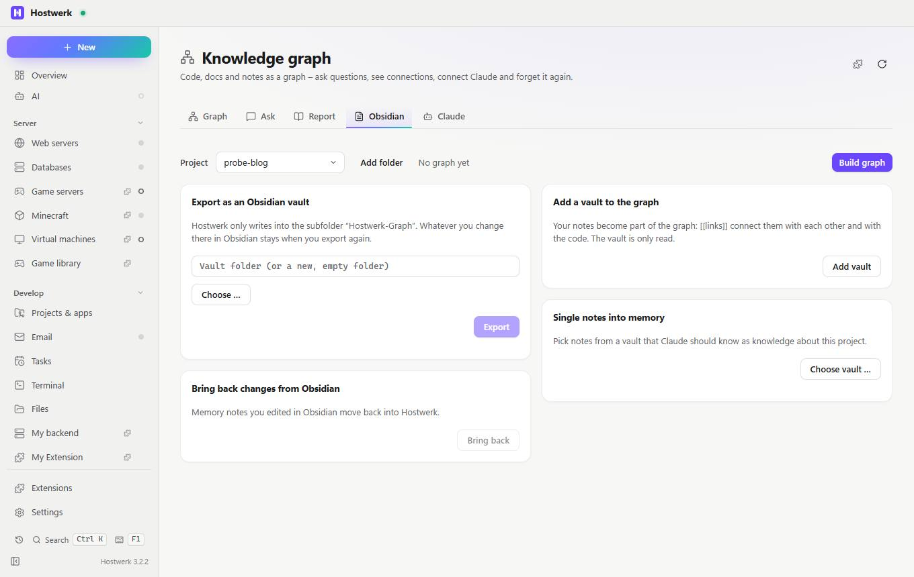
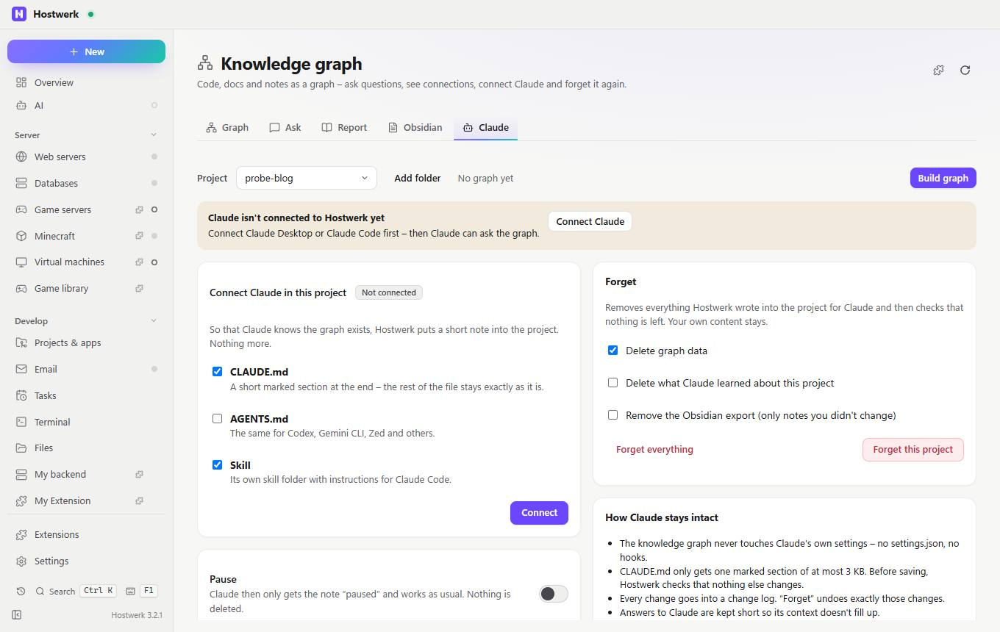

# Knowledge graph → Graph

[← Back to the overview](README.md)

Code, docs and notes as a graph – ask questions, see connections, connect Claude and forget it again.

### What you can do here

- From the extension “Knowledge graph” – info
- Reload

## Tabs

### Ask

**What you can do here:** From the extension “Knowledge graph” – info · Reload

### Report

**What you can do here:** From the extension “Knowledge graph” – info · Reload

### Obsidian

**What you can do here:** From the extension “Knowledge graph” – info · Reload

### Claude

**What you can do here:** From the extension “Knowledge graph” – info · Reload

Generated on 2026-11-20 · Hostwerk 3.2.2
