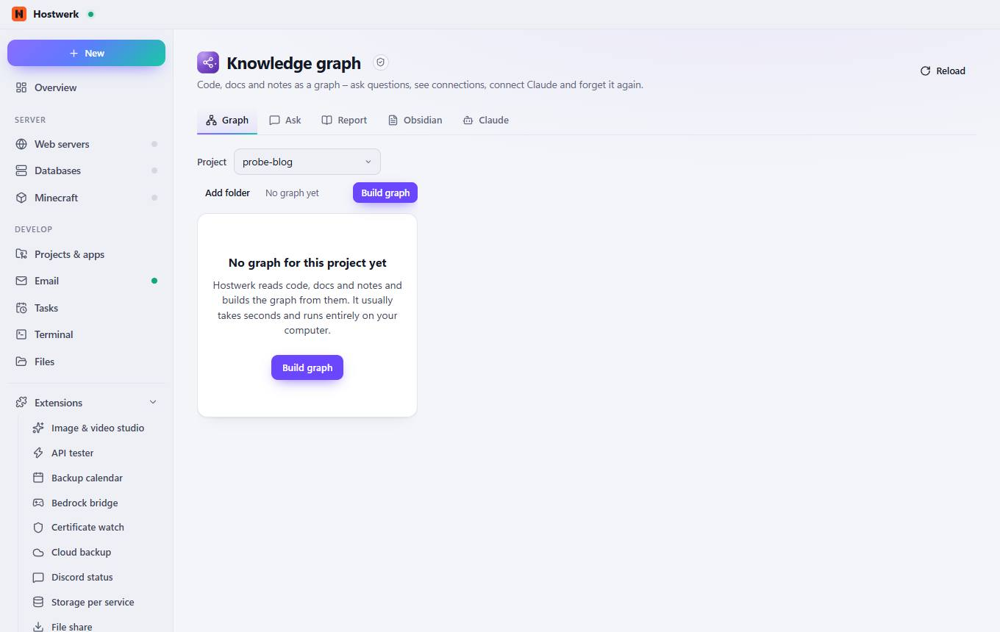
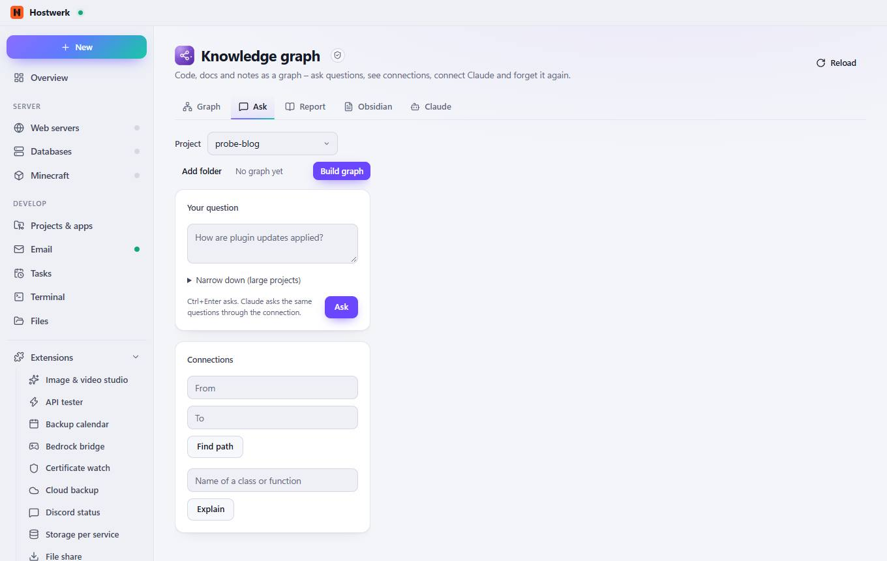
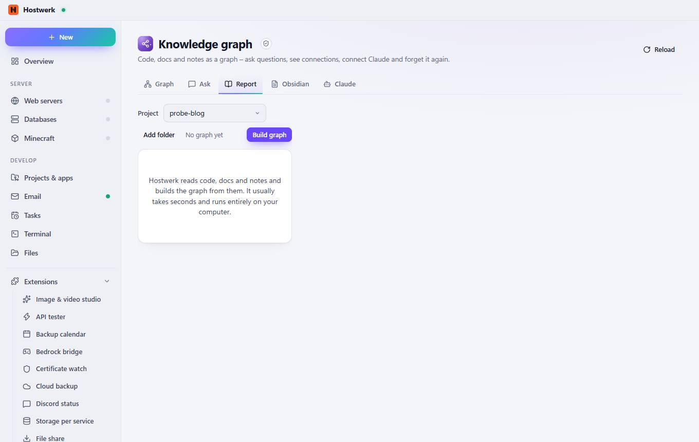
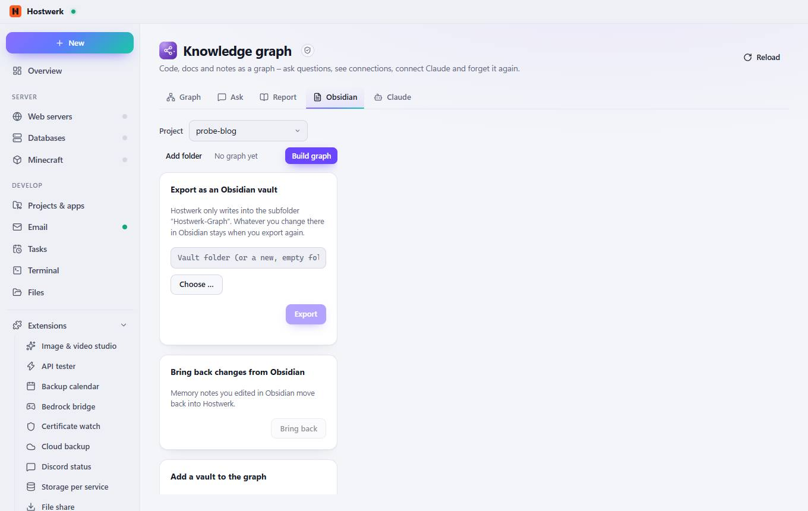
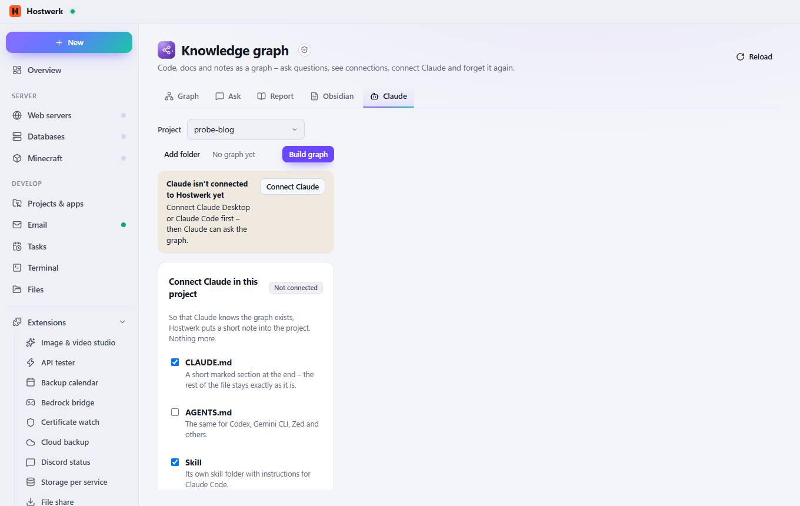

# Knowledge graph → Graph

[← Back to the overview](README.md)

Code, docs and notes as a graph – ask questions, see connections, connect Claude and forget it again.

### Good to know

- Sandboxed extension by Hostwerk · v1.4.0 · may change things after asking Read the knowledge graph (projects, graph, report, memory, Claude status) Build and query the knowledge graph, edit memory, Obsidian export Connect Claude and forget it again (asks first)

### What you can do here

- Reload

## Tabs

### Ask

> Sandboxed extension by Hostwerk · v1.4.0 · may change things after asking Read the knowledge graph (projects, graph, report, memory, Claude status) Build and query the knowledge graph, edit memory, Obsidian export Connect Claude and forget it again (asks first)

**What you can do here:** Reload

### Report

> Sandboxed extension by Hostwerk · v1.4.0 · may change things after asking Read the knowledge graph (projects, graph, report, memory, Claude status) Build and query the knowledge graph, edit memory, Obsidian export Connect Claude and forget it again (asks first)

**What you can do here:** Reload

### Obsidian

> Sandboxed extension by Hostwerk · v1.4.0 · may change things after asking Read the knowledge graph (projects, graph, report, memory, Claude status) Build and query the knowledge graph, edit memory, Obsidian export Connect Claude and forget it again (asks first)

**What you can do here:** Reload

### Claude

> Sandboxed extension by Hostwerk · v1.4.0 · may change things after asking Read the knowledge graph (projects, graph, report, memory, Claude status) Build and query the knowledge graph, edit memory, Obsidian export Connect Claude and forget it again (asks first)

**What you can do here:** Reload

Generated on 2026-10-20 · Hostwerk 2.10.0
