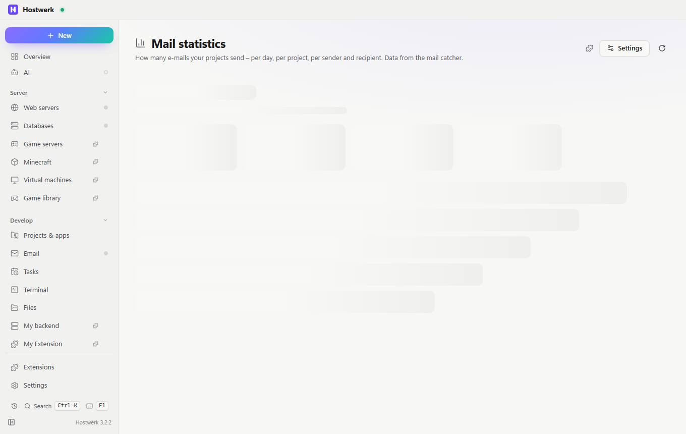

# Mail statistics

[← Back to the overview](README.md)

How many e-mails your projects send – per day, per project, per sender and recipient. Data from the mail catcher.

### What you can do here

- From the extension “Mail statistics” – info
- Settings
- Reload

Generated on 2026-11-20 · Hostwerk 3.3.0
