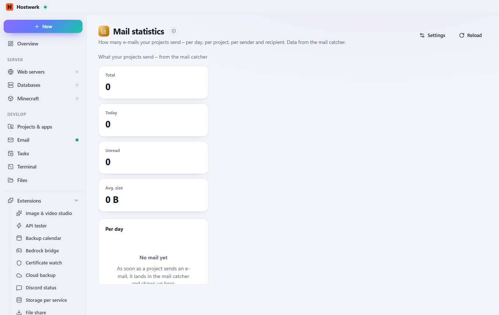

# Mail statistics

[← Back to the overview](README.md)

How many e-mails your projects send – per day, per project, per sender and recipient. Data from the mail catcher.

### Good to know

- Sandboxed extension by Hostwerk · v1.2.0 · read only Read captured e-mails

### What you can do here

- Settings
- Reload

Generated on 2026-10-20 · Hostwerk 2.10.0
