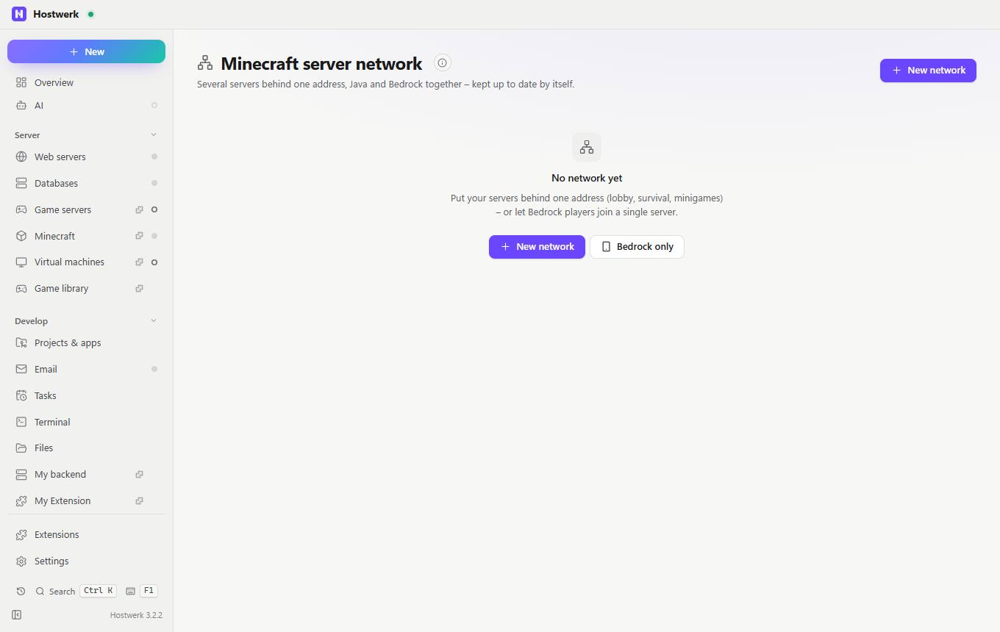

# Minecraft server network

[← Back to the overview](README.md)

Several servers behind one address, Java and Bedrock together – kept up to date by itself.

### Good to know

- How it fits together A proxy (Velocity) is the one address players connect to; it sends them to your servers and lets them switch with /server. Geyser on the proxy translates for Bedrock players (phone, console, Windows), Floodgate lets them in without a Java account. ViaVersion lets other Minecraft versions in. A Bedrock Dedicated Server is something else: Mojang’s own server with a separate Bedrock-only world.

### What you can do here

- New network
- Bedrock only

Generated on 2026-11-20 · Hostwerk 3.2.2
