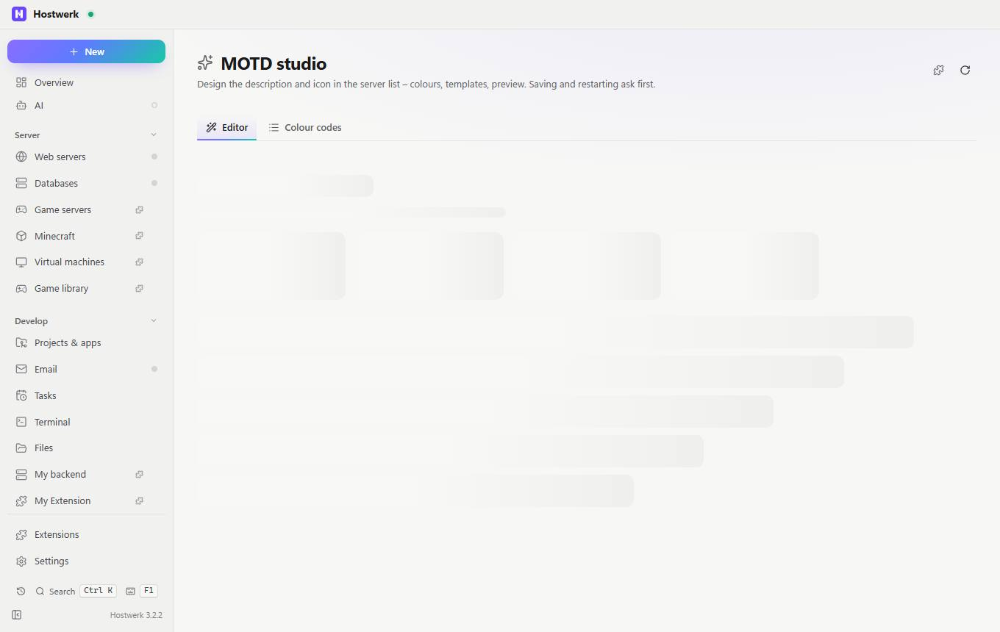
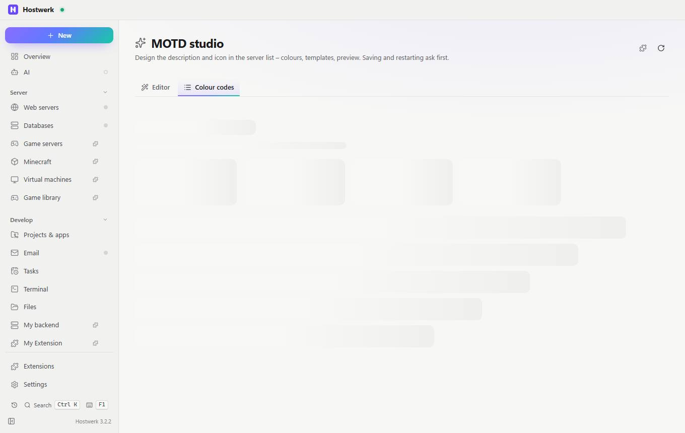

# MOTD studio → Editor

[← Back to the overview](README.md)

Design the description and icon in the server list – colours, templates, preview. Saving and restarting ask first.

### What you can do here

- From the extension “MOTD studio” – info
- Reload

## Tabs

### Colour codes

**What you can do here:** From the extension “MOTD studio” – info · Reload

Generated on 2026-11-20 · Hostwerk 3.2.2
